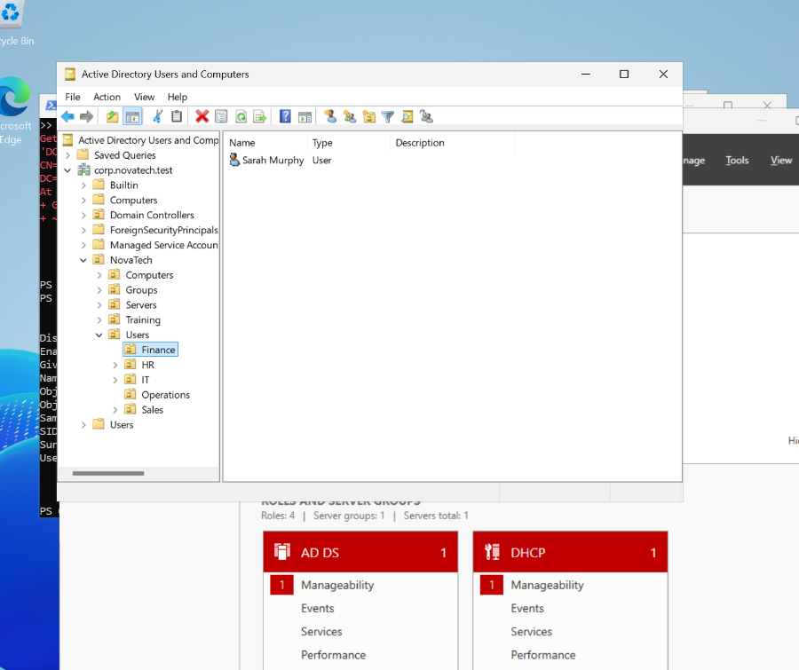
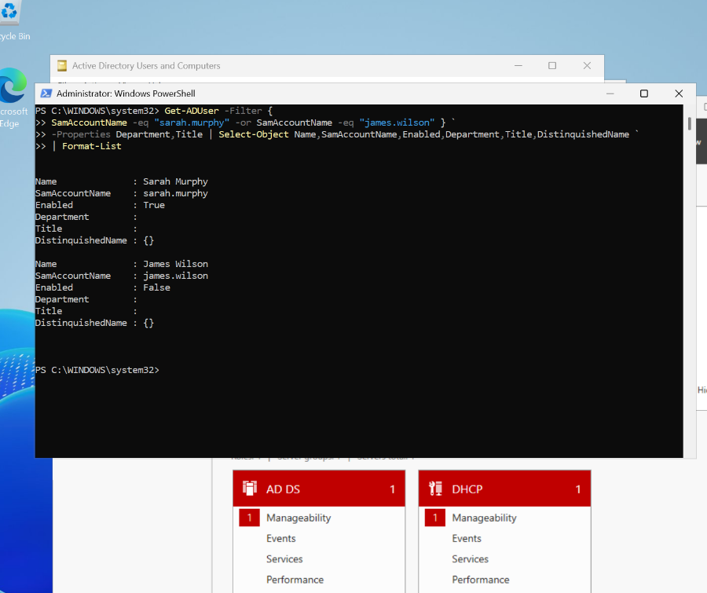
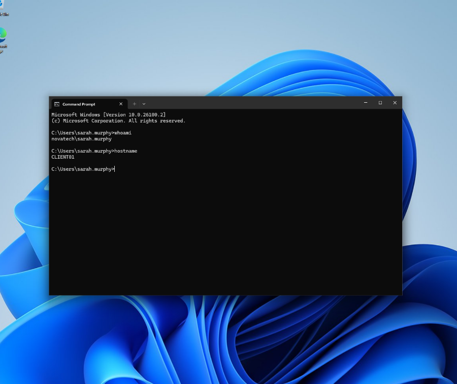

# Active Directory User Provisioning and Domain Sign-In

**Project:** NovaTech Enterprise Windows IT Support Lab  
**Environment:** Windows Server 2025 (DC01), Windows 11 (CLIENT01), VirtualBox  
**Domain:** `corp.novatech.test`  
**Status:** Sarah Murphy's domain sign-in verified. Verify James Wilson's account before marking his provisioning complete.

## Objective

Provision standard employee accounts in Active Directory, organize them by department, inspect account attributes using PowerShell, and validate that an employee can sign in to a domain-joined workstation without using a domain administrator account.

## Lab prerequisites

- DC01 is promoted as an Active Directory domain controller and hosts AD-integrated DNS.
- CLIENT01 is joined to `corp.novatech.test`.
- CLIENT01 can discover and contact DC01 on the lab network.
- The `NovaTech > Users > Finance` and `NovaTech > Users > IT` organizational units exist.

## Account design

| Attribute | Finance account | IT account |
| --- | --- | --- |
| Display name | Sarah Murphy | James Wilson |
| sAMAccountName | `sarah.murphy` | `james.wilson` |
| UPN | `sarah.murphy@corp.novatech.test` | `james.wilson@corp.novatech.test` |
| OU | `OU=Finance,OU=Users,OU=NovaTech,DC=corp,DC=novatech,DC=test` | `OU=IT,OU=Users,OU=NovaTech,DC=corp,DC=novatech,DC=test` |
| Job title | Finance Assistant | IT Support Technician |

These are fictional lab identities.

## Implementation

### 1. Create a user in Active Directory Users and Computers

1. On DC01, open **Server Manager > Tools > Active Directory Users and Computers** (`dsa.msc`).
2. Navigate to **corp.novatech.test > NovaTech > Users > Finance**.
3. Right-click **Finance**, choose **New > User**, and enter Sarah's name and `sarah.murphy` as the sign-in name.
4. Set a unique temporary password compliant with domain policy. Enable **User must change password at next logon**. Do not enable administrative privileges for this employee.
5. Finish the wizard and confirm the user appears in the Finance OU.

### 2. Inspect and update the account with PowerShell

```powershell
Get-ADUser -Identity 'sarah.murphy'

Set-ADUser -Identity 'sarah.murphy' `
    -Department 'Finance' `
    -Title 'Finance Assistant' `
    -EmailAddress 'sarah.murphy@novatech.example'

Get-ADUser -Identity 'sarah.murphy' -Properties Department,Title,EmailAddress |
    Select-Object Name,SamAccountName,Enabled,Department,Title,EmailAddress,DistinguishedName
```

### 3. Provision an IT employee with PowerShell

```powershell
$domainDN = (Get-ADDomain).DistinguishedName
$itOU = "OU=IT,OU=Users,OU=NovaTech,$domainDN"
$password = Read-Host 'Enter temporary password for James' -AsSecureString

New-ADUser `
    -Name 'James Wilson' `
    -GivenName 'James' `
    -Surname 'Wilson' `
    -SamAccountName 'james.wilson' `
    -UserPrincipalName 'james.wilson@corp.novatech.test' `
    -Path $itOU `
    -Department 'IT' `
    -Title 'IT Support Technician' `
    -AccountPassword $password `
    -Enabled $true `
    -ChangePasswordAtLogon $true
```

This is a record of the intended PowerShell procedure; verify that the account was created successfully before describing it as completed.

### 4. Verify account objects on DC01

```powershell
Get-ADUser -Filter {
    SamAccountName -eq 'sarah.murphy' -or
    SamAccountName -eq 'james.wilson'
} -Properties Department,Title |
    Select-Object Name,SamAccountName,Enabled,Department,Title,DistinguishedName |
    Format-List
```

Check that each account appears in its intended OU and that `Enabled` is `True`. If James does not appear, complete or troubleshoot his creation before recording success.

### 5. Test domain authentication on CLIENT01

1. Sign out of the administrator session on CLIENT01.
2. Sign in using `NOVATECH\sarah.murphy` and the temporary password.
3. If required, change the temporary password at first sign-in.
4. Open PowerShell in Sarah's session:

```powershell
whoami
hostname
```

**Observed result:** Sarah Murphy successfully signed in to CLIENT01 using her domain account. The commands above provide screenshot-ready confirmation of the signed-in identity and workstation name.

## Evidence

### Sarah Murphy in the Finance OU



### PowerShell account verification



### Successful domain user sign-in on CLIENT01



## Concepts learned

- **Local vs domain users:** Domain users are managed centrally in AD; local users are managed on individual machines.
- **sAMAccountName:** Traditional account name used in `NOVATECH\sarah.murphy`.
- **UPN:** Alternative sign-in name, e.g. `sarah.murphy@corp.novatech.test`.
- **Distinguished Name (DN):** The directory address identifying the user object's location.
- **Organizational Units:** Organize objects and support delegated administration and Group Policy scope; OU placement alone does not grant file access.
- **Authentication vs authorization:** A successful sign-in proves authentication, not access to every corporate resource.
- **Least privilege:** Ordinary employee accounts should not be provisioned as domain administrators.

## Outcome and next steps

**Confirmed:** Sarah Murphy successfully authenticated to the domain on CLIENT01.

**To verify before finalizing this milestone:** Both user objects appear in AD with correct attributes and OU placement, and James Wilson is enabled.

**Next exercises:** Password resets, account enable/disable, account lockout investigation, moving users between OUs, searching/filtering users, bulk provisioning, and security group membership.

## Security notes

Do not commit passwords, password hashes, credentials, employee personal information, VM disks or secret configuration files. Screenshots must not expose passwords. Use fictional employee details in this portfolio lab.
