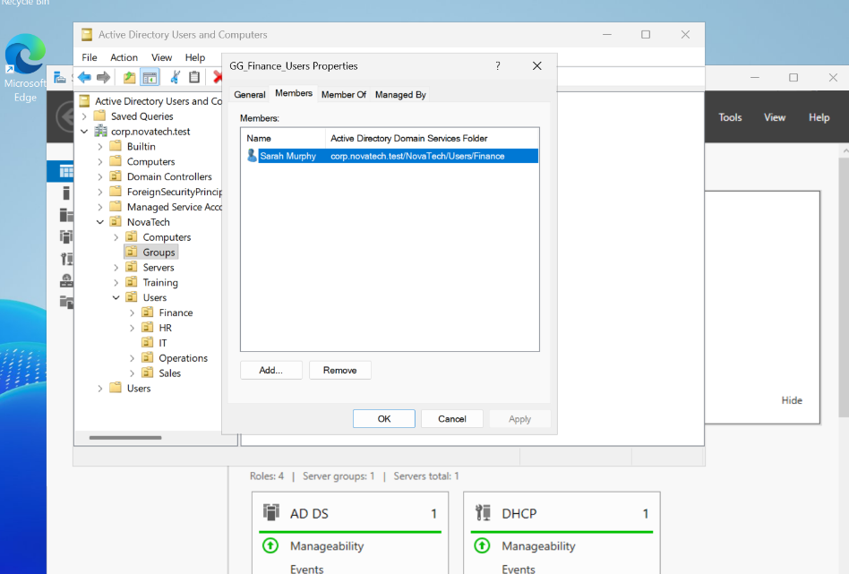
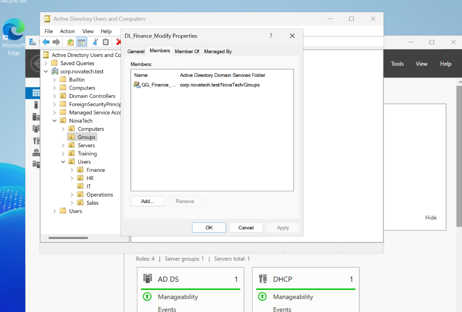
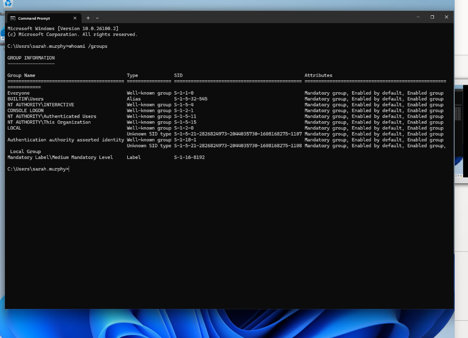
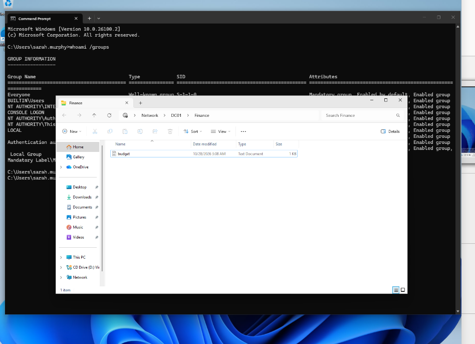
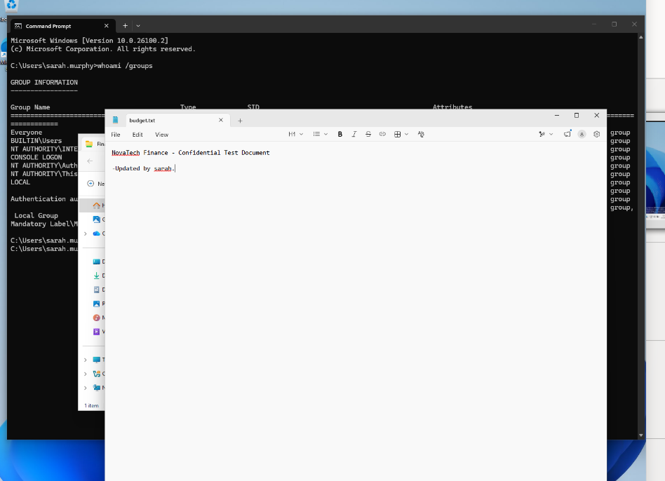
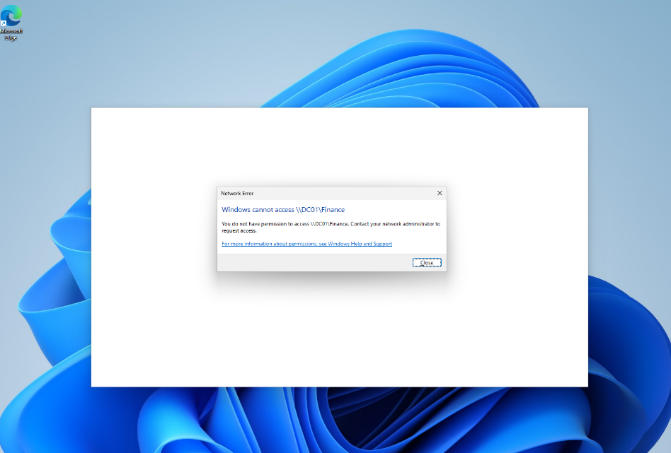

# LAB-013 — Active Directory Group-Based File Access Control (AGDLP)

**Project:** NovaTech Enterprise IT Support Lab  
**Environment:** Windows Server 2025 (DC01), Windows 11 (CLIENT01), VirtualBox  
**Domain:** `corp.novatech.test` (`NOVATECH`)  
**Date:** October 2026  
**Status:** Completed — authorized and unauthorized access tested

## 1. Overview

This lab demonstrates how to manage access to a departmental network share using Active Directory security groups, the **AGDLP** model, NTFS permissions, and SMB share permissions.

**Scenario:** NovaTech's Finance team needs to read and modify departmental documents. An ordinary employee from another department must not have access to those documents.

The lab uses **DC01** to host the test share because the virtual environment has limited resources. In a typical production environment, the same NTFS and SMB configuration would be applied on a dedicated, domain-joined member file server (for example, `FS01`), while Active Directory users and groups would continue to be managed centrally.

## 2. Objectives

- Understand the difference between **Security** group category and **Global** / **Domain Local** group scopes.
- Implement **AGDLP**: Accounts → Global groups → Domain Local groups → Permissions.
- Configure explicit NTFS permissions and safely control inheritance.
- Configure SMB share permissions for the same resource-specific group.
- Verify authorized access as a Finance employee and denied access as an IT employee.
- Troubleshoot group membership visibility in a Windows logon token.

## 3. Environment

| Component | Value |
|---|---|
| Domain controller / share host | `DC01` — Windows Server 2025 |
| Client | `CLIENT01` — Windows 11 |
| Domain | `corp.novatech.test` |
| NetBIOS domain | `NOVATECH` |
| DC01 internal IP | `192.168.10.10` |
| Internal subnet | `192.168.10.0/24` |
| Local folder | `C:\NovaTechData\Finance` |
| Network share | `\\DC01\Finance` |
| Authorized test account | `NOVATECH\sarah.murphy` |
| Unauthorized test account | `NOVATECH\james.wilson` |
| Role group | `GG_Finance_Users` — Global, Security |
| Permission group | `DL_Finance_Modify` — Domain Local, Security |

## 4. Access-control design

### 4.1 AGDLP

```text
Account                  Global group            Domain Local group       Permissions

NOVATECH\sarah.murphy -> GG_Finance_Users  ->  DL_Finance_Modify  ->  NTFS: Modify
                                                                    SMB: Change
                                                                          |
                                                                          v
                                                                  \\DC01\Finance
```

**Why two groups?** `GG_Finance_Users` represents the Finance role or department. `DL_Finance_Modify` represents a specific permission on a specific resource. This separates *who the employees are* from *which resource permissions they receive*.

AGDLP is an administration pattern, **not a mandatory Windows feature**. A Global group can be assigned directly to an ACL, but the additional Domain Local group can simplify management when resources and permissions grow.

### 4.2 Verify group membership

On DC01:

```powershell
Get-ADGroupMember -Identity "GG_Finance_Users" |
    Select-Object Name,SamAccountName,ObjectClass

Get-ADGroupMember -Identity "DL_Finance_Modify" |
    Select-Object Name,SamAccountName,ObjectClass

Get-ADGroupMember -Identity "DL_Finance_Modify" -Recursive |
    Select-Object Name,SamAccountName,ObjectClass
```

Verified membership: Sarah Murphy belongs to `GG_Finance_Users`, and `GG_Finance_Users` is nested inside `DL_Finance_Modify`.



*Figure 1 — Finance Global security group membership.*



*Figure 2 — Global group nested into the Domain Local permission group.*

## 5. NTFS folder permissions

### 5.1 Create the folder and test file

On DC01, in an elevated PowerShell session:

```powershell
New-Item -Path "C:\NovaTechData\Finance" -ItemType Directory -Force

Set-Content -Path "C:\NovaTechData\Finance\budget.txt" `
    -Value "NovaTech Finance - Confidential Test Document"
```

### 5.2 Inspect the initial ACL

```powershell
Get-Acl -Path "C:\NovaTechData\Finance" |
    Format-List Owner,AccessToString

icacls "C:\NovaTechData\Finance"
```

The initial ACL contained inherited `BUILTIN\Users` Allow entries, including Read & Execute and rights to add files or subdirectories. Adding a Finance group would **not** automatically remove those broader rights.

### 5.3 Grant Finance Modify access

```powershell
icacls "C:\NovaTechData\Finance" `
    /grant "NOVATECH\DL_Finance_Modify:(OI)(CI)M"
```

| Flag | Meaning |
|---|---|
| `(OI)` | Object Inherit: child files can inherit the ACE |
| `(CI)` | Container Inherit: child directories can inherit the ACE |
| `(M)` | Modify: read, create, edit and generally delete files, subject to applicable access checks |
| `(I)` | The displayed ACE was inherited from a parent |
| `(F)` | Full Control |
| `(IO)` | Inherit Only: does not apply to the current object |

### 5.4 Back up the ACL before changing inheritance

```powershell
New-Item -Path "C:\NovaTechACLBackup" -ItemType Directory -Force

icacls "C:\NovaTechData\Finance" `
    /save "C:\NovaTechACLBackup\finance-acl.txt"
```

This saves DACL information for recovery. It is **not** a backup of the documents, ownership, or every security descriptor component.

### 5.5 Disable inheritance safely

```powershell
icacls "C:\NovaTechData\Finance" /inheritancelevel:d
```

The `d` option disables inheritance **and copies the inherited ACEs as explicit ACEs**. It does not delete them. This was chosen so that required SYSTEM and administrator access would be preserved before removing unnecessary entries.

### 5.6 Remove broad Users Allow entries

After verifying that SYSTEM and Administrators still had Full Control:

```powershell
icacls "C:\NovaTechData\Finance" /remove:g "BUILTIN\Users"
```

The `/remove:g` option removes **Allow ACEs** for the specified principal from the target ACL. It does not delete the Windows group or user accounts.

### 5.7 Verify the final folder ACL

```powershell
icacls "C:\NovaTechData\Finance"
```

Observed output:

```text
C:\NovaTechData\Finance BUILTIN\Administrators:(F)
                        NOVATECH\DL_Finance_Modify:(OI)(CI)(M)
                        NT AUTHORITY\SYSTEM:(OI)(CI)(F)
                        BUILTIN\Administrators:(OI)(CI)(F)
                        CREATOR OWNER:(OI)(CI)(IO)(F)

Successfully processed 1 files; Failed processing 0 files
```

**Interpretation:** The Finance folder has no inherited `(I)` ACEs, broad `BUILTIN\Users` Allow entries are absent, and Finance Modify plus essential system/administrative entries remain. The two Administrators entries have different inheritance flags; their coexistence is not inherently an error.


*Figure 3 — Final Finance folder ACL.*

### 5.8 Verify the test file ACL

```powershell
icacls "C:\NovaTechData\Finance\budget.txt"
```

Observed output:

```text
C:\NovaTechData\Finance\budget.txt NOVATECH\DL_Finance_Modify:(I)(M)
                                   NT AUTHORITY\SYSTEM:(I)(F)
                                   BUILTIN\Administrators:(I)(F)

Successfully processed 1 files; Failed processing 0 files
```

The folder **does not inherit from its parent**, while `budget.txt` **does inherit from the Finance folder**. These are separate inheritance relationships and are compatible.

## 6. SMB share configuration

### 6.1 Create the network share

On DC01:

```powershell
New-SmbShare `
    -Name "Finance" `
    -Path "C:\NovaTechData\Finance" `
    -ChangeAccess "NOVATECH\DL_Finance_Modify" `
    -FullAccess "BUILTIN\Administrators"
```

This publishes the folder at `\\DC01\Finance`.

### 6.2 Verify share permissions

```powershell
Get-SmbShareAccess -Name "Finance" |
    Format-Table AccountName,AccessControlType,AccessRight -AutoSize
```

Observed output:

```text
AccountName                AccessControlType AccessRight
-----------                ----------------- -----------
BUILTIN\Administrators                 Allow        Full
NOVATECH\DL_Finance_Modify             Allow      Change
```

For access over SMB, both **share permissions** and **NTFS permissions** must permit the requested operation. Share Change does not override NTFS restrictions, and NTFS Modify does not override share restrictions.


*Figure 4 — Finance SMB share ACL.*

## 7. Access tests from CLIENT01

### 7.1 Test A — Authorized Finance user (Sarah)

Signed in to CLIENT01 as `NOVATECH\sarah.murphy`.

Verified identity and group token:

```cmd
whoami
whoami /groups
```

After a fresh sign-in, `GG_Finance_Users` and `DL_Finance_Modify` appeared in Sarah's group output.



*Figure 5 — Sarah's current Windows group memberships.*

Opened File Explorer and entered:

```text
\\DC01\Finance
```

**Observed:** Sarah could open the share, read `budget.txt`, edit its contents, and save the changes.



*Figure 6 — Authorized access to the Finance share.*



*Figure 7 — Successful modification of the Finance test document.*

**Result: PASS** — The authorized Finance account could read and modify the test file.

### 7.2 Test B — Unauthorized IT user (James)

Signed Sarah out and signed in to CLIENT01 as `NOVATECH\james.wilson`.

Attempted to open:

```text
\\DC01\Finance
```

**Observed:** Windows displayed a network access permission error. James could not open the Finance share using his ordinary account.



*Figure 8 — Unauthorized account denied access.*

**Result: PASS** — The ordinary IT account was denied access as intended.

### 7.3 Test summary

| Test | Expected | Observed | Result |
|---|---|---|---|
| Sarah opens `\\DC01\Finance` | Allowed | Allowed | PASS |
| Sarah reads `budget.txt` | Allowed | Allowed | PASS |
| Sarah edits and saves `budget.txt` | Allowed | Allowed | PASS |
| James opens `\\DC01\Finance` | Denied | Denied | PASS |

These tests validate the observed behavior for the two accounts and operations tested; they are not a comprehensive security audit of every possible account or access path.

## 8. Troubleshooting: Finance groups missing from `whoami /groups`

### Symptom

During the initial CLIENT01 test, Sarah's `whoami /groups` output listed standard built-in groups but did not display the expected NovaTech domain groups.

### Investigation

Confirmed the active account and domain-related logon environment:

```cmd
whoami
echo %USERDNSDOMAIN%
echo %LOGONSERVER%
```

Observed:

```text
novatech\sarah.murphy
CORP.NOVATECH.TEST
\\DC01
```

Checked Active Directory membership on DC01:

```powershell
Get-ADPrincipalGroupMembership -Identity "sarah.murphy" |
    Select-Object Name,GroupScope,GroupCategory

Get-ADGroupMember -Identity "GG_Finance_Users" |
    Select-Object Name,SamAccountName,ObjectClass
```

AD confirmed that Sarah was a member of `GG_Finance_Users`.

### Resolution and lesson learned

After Sarah **signed out and signed in again**, the expected Finance Global and Domain Local groups appeared in `whoami /groups`.

The fresh logon resolved the observed discrepancy. A stale logon security context is a plausible explanation, especially after group membership changes, but the precise initial cause was not independently confirmed.

**Operational lesson:** When troubleshooting newly assigned domain group permissions, distinguish **membership stored in AD** from **membership represented in the current logon token**. A new sign-in can be required before group changes are reflected in a session.

## 9. Security principles demonstrated

1. **Least privilege:** Grant departmental access only to the appropriate resource group.
2. **Role/resource separation:** Manage users in a Global group and resource access through a Domain Local group.
3. **Inheritance awareness:** Review inherited ACEs before assuming a folder is restricted.
4. **Controlled changes:** Back up the ACL and preserve SYSTEM/administrator access before removing broad permissions.
5. **Layered authorization:** Configure both SMB share and NTFS permissions.
6. **Evidence-based validation:** Test with an authorized account and a separate unauthorized account.

## 10. Production comparison

| This lab | Typical dedicated file-server deployment |
|---|---|
| DC01 hosts `C:\NovaTechData\Finance` | FS01 hosts a data volume such as `D:\CompanyData\Finance` |
| Share is `\\DC01\Finance` | Share is `\\FS01\Finance` |
| AD users/groups managed in the domain | Same centrally managed AD users/groups |
| NTFS and SMB configured on DC01 | NTFS and SMB configured on FS01 |
| CLIENT01 connects to DC01 for files | CLIENT01 connects to FS01 for files |

A dedicated member file server is generally preferable for workload separation, storage management, maintenance, and reducing unnecessary services on a domain controller. The **AGDLP, NTFS, and SMB concepts remain the same**.

## 11. Conclusion

The NovaTech Finance share was successfully configured using Active Directory group nesting, NTFS permissions, and SMB share permissions. Sarah Murphy could read and modify the Finance test document, while James Wilson was denied access to the share.

The exercise also demonstrated how to diagnose a discrepancy between Active Directory membership and the groups shown in a user's current Windows logon token.

**Final result: Completed — all four recorded access tests passed.**
