# LAB-014 — Group Policy Management and Security Filtering

> **NovaTech Enterprise Windows IT Support Lab** · Windows Server 2025 / Windows 11 · Active Directory domain: `corp.novatech.test`

## Overview

This lab records the actual configuration, verification, and troubleshooting of domain Group Policy in the NovaTech simulated enterprise. The aim was to move from simple OU-linked policies to targeted deployment using Active Directory security groups, and to verify results on a domain-joined Windows 11 workstation. Each screenshot below is evidence of a specific step or outcome; this is a completed lab report, not a set of instructions for the reader to perform.

**Completed outcomes:** department-specific Control Panel restriction, Finance drive mapping, 60-second inactivity lock, restricted ICMPv4 inbound firewall rule, USB write-denial testing, and a controlled security-filtering comparison between two Finance users. WMI filtering and GPO precedence remain future exercises.

## Objective

Configure, deploy, validate, and troubleshoot domain Group Policy Objects (GPOs) in a small enterprise simulation. Demonstrate the difference between **computer** and **user** policies, OU scope, group-based security filtering, and effective policy verification on a domain-joined client.

## Lab environment

| Component | Configuration |
|---|---|
| Domain controller | `DC01.corp.novatech.test`, Windows Server 2025, internal IP `192.168.10.10` |
| Client | `CLIENT01`, Windows 11, domain joined, lab IP `192.168.10.100` |
| Domain | `corp.novatech.test` (`NOVATECH`) |
| Users | `sarah.murphy` (Finance), `michael.brown` (Finance test account), `james.wilson` (IT) |
| Organizational units | `NovaTech/Users/Finance`, `NovaTech/Users/IT`, `NovaTech/Computers`, `NovaTech/Groups` |
| Administration tools | GPMC (`gpmc.msc`), ADUC (`dsa.msc`), PowerShell, `gpupdate`, `gpresult` |

> All accounts, hostnames and addresses represent a controlled learning environment. Do not deploy these example settings to production without change review and testing.

## Core concepts

- **GPO link:** Connects a GPO to a site, domain, or OU. A GPO linked to the Finance OU can affect Finance user objects; a GPO linked to the Computers OU can affect computer objects.
- **User vs. Computer Configuration:** User settings normally follow the user; computer settings normally follow the device. Both can coexist in a GPO.
- **Security Filtering:** Limits which in-scope accounts have **Read** and **Apply Group Policy** permissions. It does not extend a GPO outside its linked scope.
- **Authentication token:** New AD group membership often requires sign-out/sign-in to appear in `whoami /groups`. `gpupdate /force` alone does not rebuild the user's existing logon token.
- **Verification:** A successful `gpupdate` only confirms refresh completed. Use `gpresult` and functional tests to establish which GPOs actually applied.

## Exercise 1 — Finance Control Panel restriction

**GPO:** `GPO_Finance_Restrict_ControlPanel`  
**Link:** `NovaTech/Users/Finance`  
**Setting:** User Configuration → Policies → Administrative Templates → Control Panel → **Prohibit access to Control Panel and PC settings** → Enabled.

I created and linked a user-scoped GPO to the Finance OU to prohibit access to Control Panel and PC settings. This established the basic workflow: create a GPO, link it to the OU containing target user accounts, edit its User Configuration setting, refresh the client, and inspect the applied policy. The restriction was temporarily set to Not Configured during other exercises, then re-enabled and reused for the more selective security-filtering experiment in Exercise 6. The uploaded editor screenshot documents the policy navigation; the later Sarah restriction screenshot provides the actual functional confirmation.

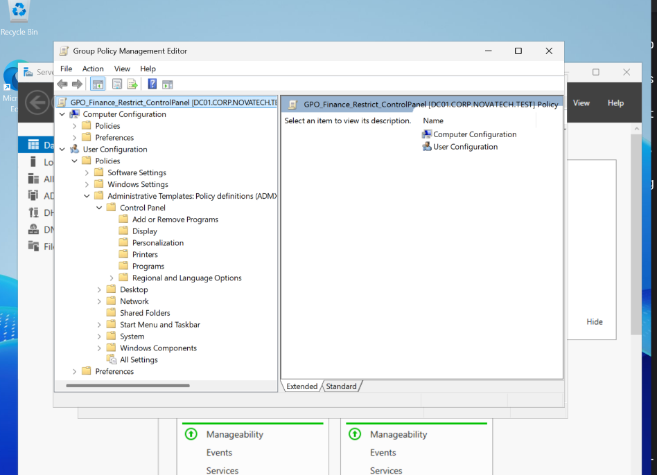

## Exercise 2 — Finance network drive mapping

**GPO:** `GPO_Finance_Drive_Mapping`  
**Link:** Finance OU  
**Path:** User Configuration → Preferences → Windows Settings → Drive Maps  
**Drive:** `F:` → `\\DC01\Finance` (Update, reconnect).

I configured a Group Policy Preference drive map using **Update** action, location `\\DC01\Finance`, drive letter `F:`, and reconnect enabled. This connected Finance users to the department share without requiring manual mapping at each sign-in. During the lab, Sarah deleted the mapped drive with `net use F: /delete`; after `gpupdate /target:user /force`, the drive was mapped again. This demonstrated the difference between a preference that configures a resource and a policy that restricts behavior. Previously tested as Sarah using `net use`; the drive reappeared following a user policy refresh. The provided current screenshots independently show `GPO_Finance_Drive_Mapping` in Sarah's and Michael's applied GPO lists, but **do not contain the original drive-map configuration or F: mapping evidence**. Add those screenshots if available.

```powershell
net use
gpupdate /target:user /force
net use
```

## Exercise 3 — Workstation inactivity lock

**GPO:** `GPO_Workstations_Security_Baseline`  
**Link:** `NovaTech/Computers`  
**Setting:** Computer Configuration → Policies → Windows Settings → Security Settings → Local Policies → Security Options → **Interactive logon: Machine inactivity limit** = **60 seconds**.

I configured the inactivity limit at the **computer** level so the setting follows the workstation regardless of which user signs in. The client registry showed `InactivityTimeoutSecs=60`, and `gpresult /scope computer /r` showed the baseline GPO applied. The workstation initially did not lock as expected during testing; after reboot, automatic locking worked. The uploaded screenshots confirm the configuration and registry value, while the actual lock behavior was observed but not captured.

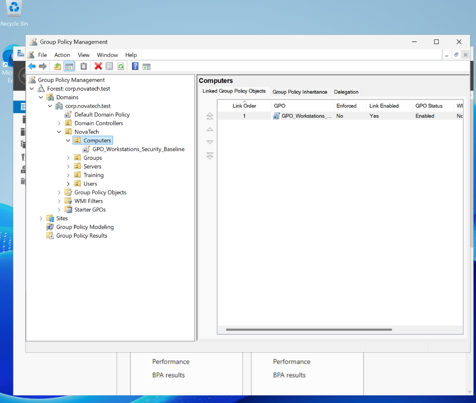
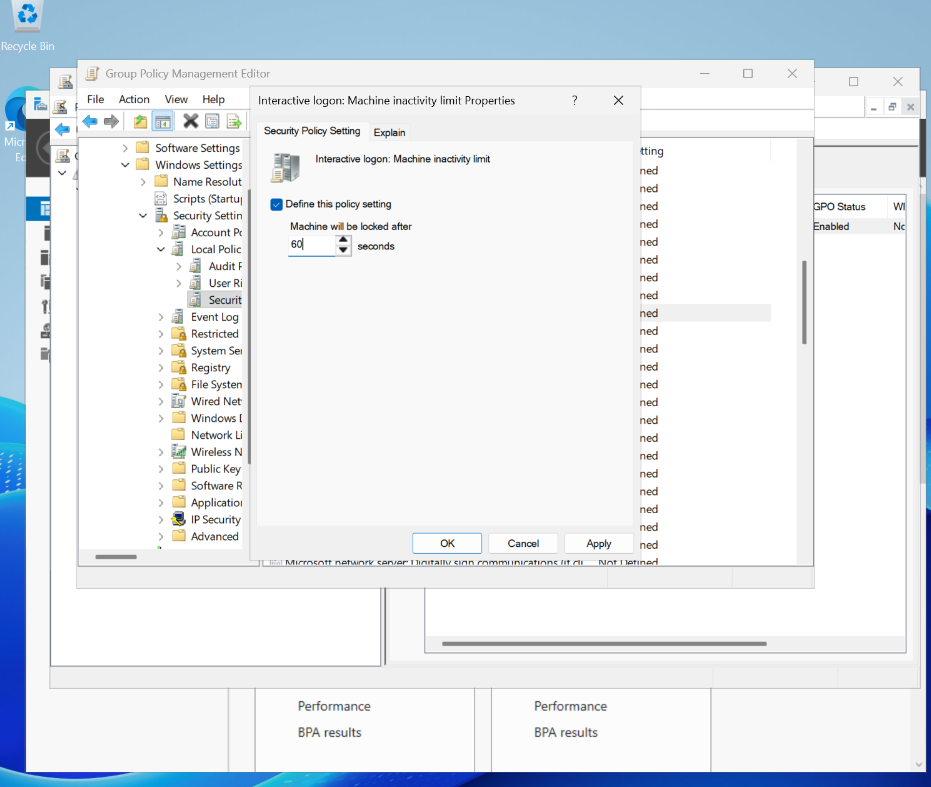
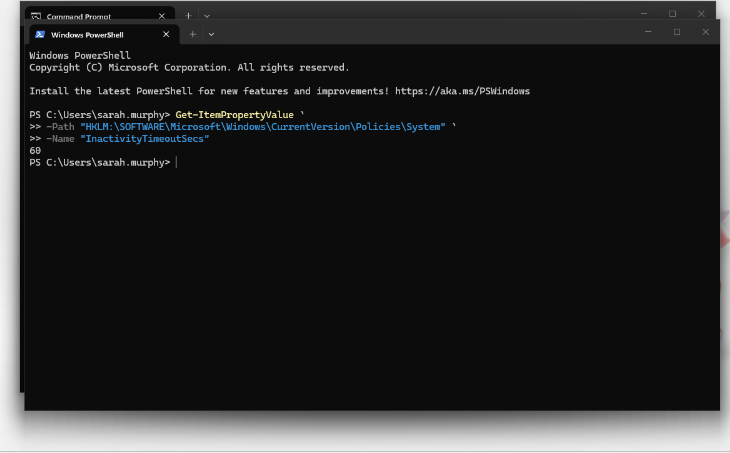
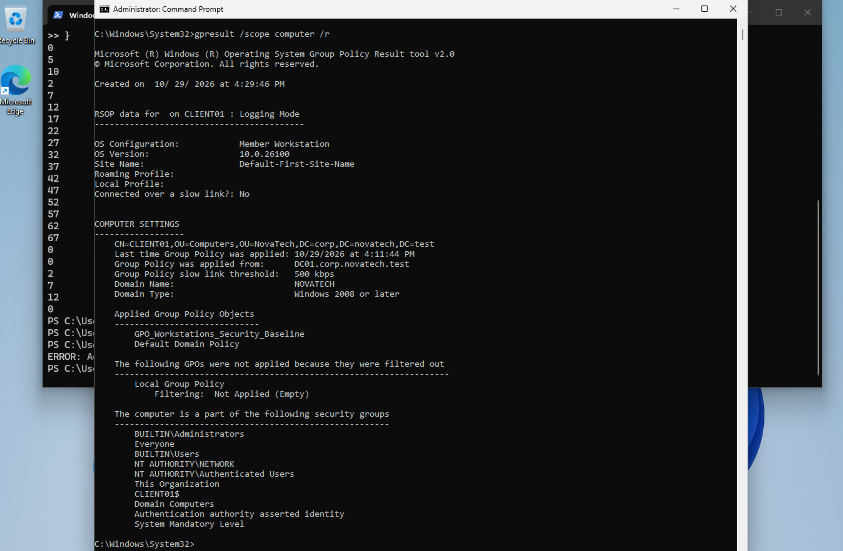

```powershell
Get-ItemPropertyValue -Path 'HKLM:\SOFTWARE\Microsoft\Windows\CurrentVersion\Policies\System' -Name InactivityTimeoutSecs
gpresult /scope computer /r
```

## Exercise 4 — Firewall: permit ICMPv4 echo from DC01

**GPO:** `GPO_Workstations_Security_Baseline`  
**Setting:** Computer Configuration → Policies → Windows Settings → Security Settings → Windows Defender Firewall with Advanced Security → Inbound Rules.

I added a custom inbound **ICMPv4 Echo Request** allow rule to the existing workstation baseline GPO, selected the Domain profile, and restricted the permitted remote address to `192.168.10.10` (DC01). This intentionally allows a management host to ping the client without opening ICMP echo to every source. After policy refresh, CLIENT01 reported the rule active in its effective firewall rules; DC01 successfully pinged CLIENT01 (`192.168.10.100`, 4 replies, 0% loss).

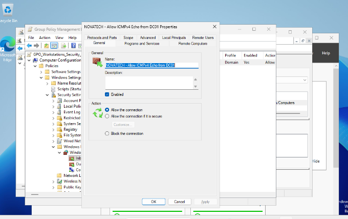
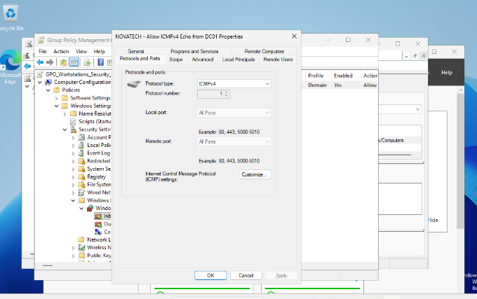
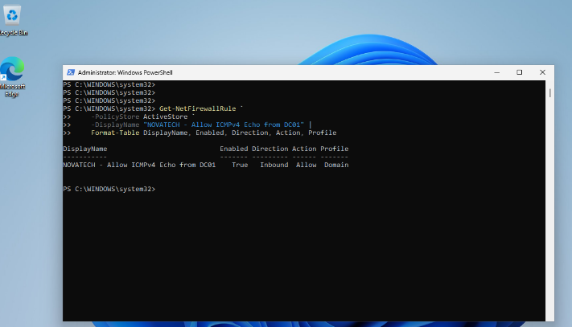
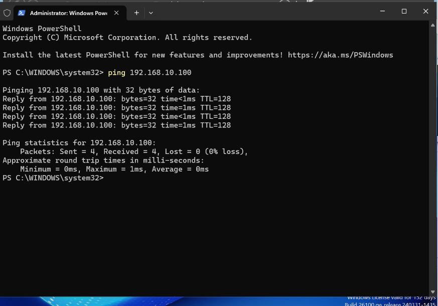

```powershell
# CLIENT01: inspect effective policy
Get-NetFirewallRule -PolicyStore ActiveStore |
  Where-Object DisplayName -like '*NOVATECH*' |
  Format-Table DisplayName,Enabled,Direction,Action,Profile

# DC01
ping 192.168.10.100
```

## Exercise 5 — USB removable disk write restriction

**GPO:** `GPO_Workstation_Restrict_USB_Write`  
**Link:** `NovaTech/Computers`  
**Setting:** Computer Configuration → Policies → Administrative Templates → System → Removable Storage Access → **Removable Disks: Deny write access** = Enabled.

I created a separate computer-scoped GPO to deny writing to removable disks, linked it to the Computers OU, and enabled **Removable Disks: Deny write access**. `gpresult /scope computer /r` confirmed the GPO applied. The initial Explorer prompt requesting administrator permission was **not sufficient evidence by itself**. A subsequent PowerShell `Set-Content` write to the attached INTENSO USB device (`E:`) returned **Access to the path is denied**, providing stronger functional evidence. The screenshot does not independently isolate the GPO as the sole possible cause of denial; a before/after controlled comparison would strengthen attribution.

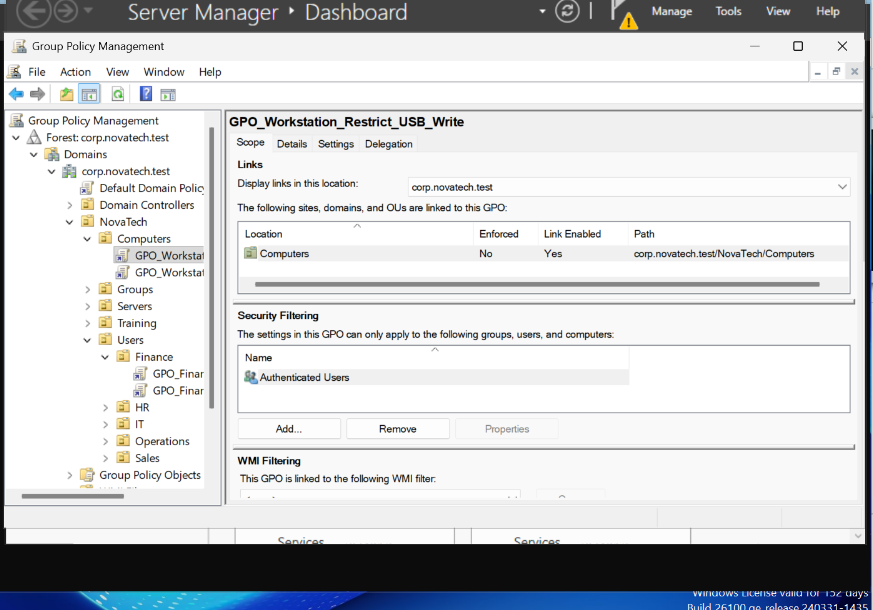
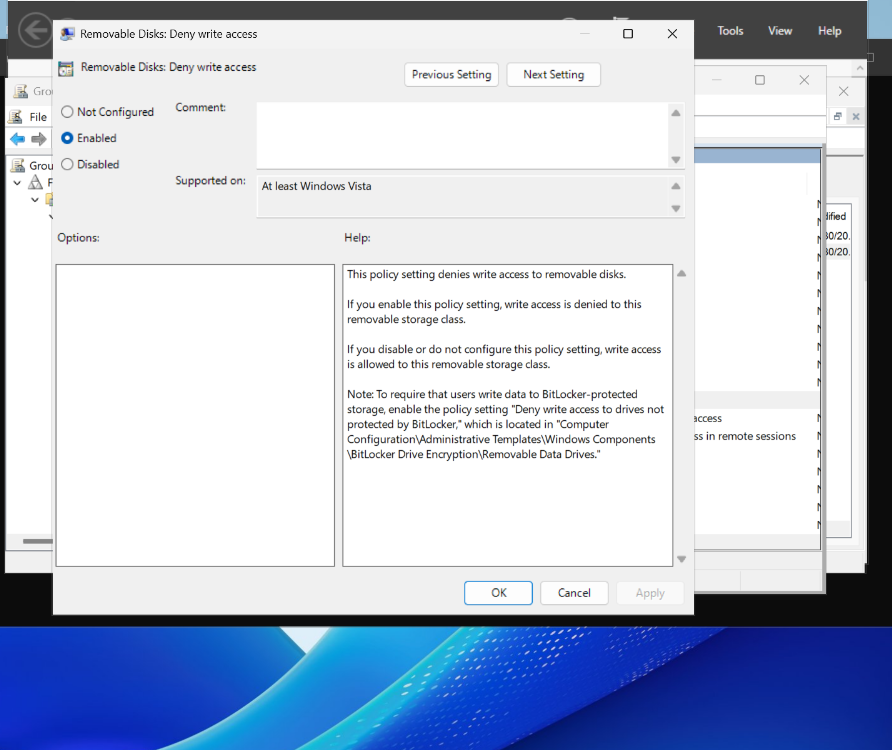
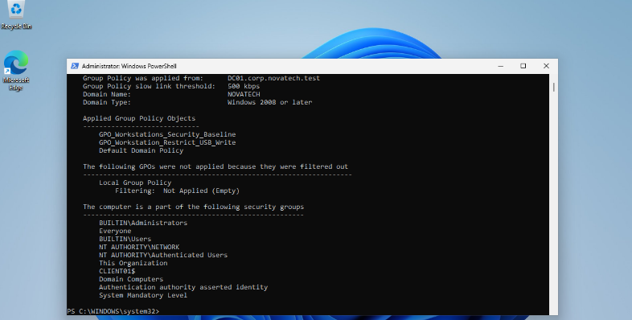
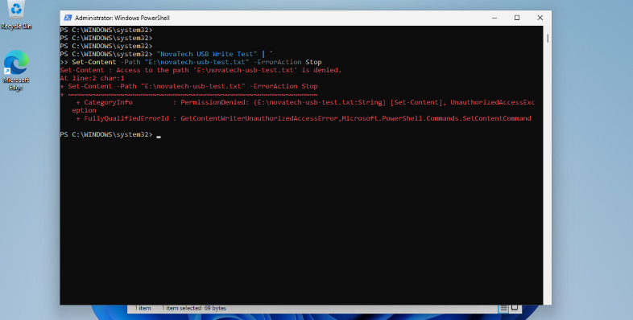

```powershell
# CLIENT01, with USB connected as E:
gpresult /scope computer /r
'NovaTech USB Write Test' | Set-Content -Path 'E:\novatech-usb-test.txt' -ErrorAction Stop
```

**Troubleshooting note:** The Explorer administrator-permission prompt is retained as optional supporting evidence, not proof of GPO enforcement: [Explorer prompt](../../screenshots/group-policy/15-usb-explorer-permission-prompt.png).

## Exercise 6 — Security filtering by AD security group

**GPO:** `GPO_Finance_Restrict_ControlPanel`  
**Link:** Finance OU  
**Target group:** `GG_Finance_ControlPanel_Restricted` (Global, Security)  
**Group member:** Sarah Murphy. **Non-member test user:** Michael Brown (also in Finance OU).

### Configuration

1. Created the Global Security group in `NovaTech/Groups` and added Sarah.
2. In GPMC → GPO → **Scope** → **Security Filtering**, selected the target group instead of broad application to Authenticated Users.
3. In **Delegation → Advanced**, confirmed the target group had **Read** and **Apply Group Policy** permissions. Retained read access needed for user-policy processing without broadly granting Apply Group Policy.
4. Verified both Sarah and Michael were located in the same Finance OU.

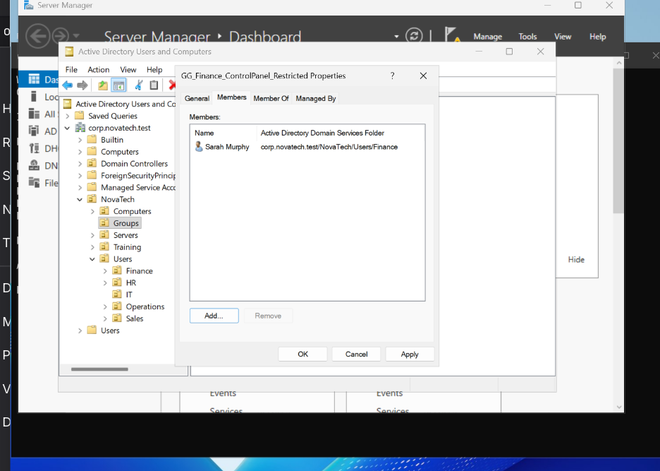
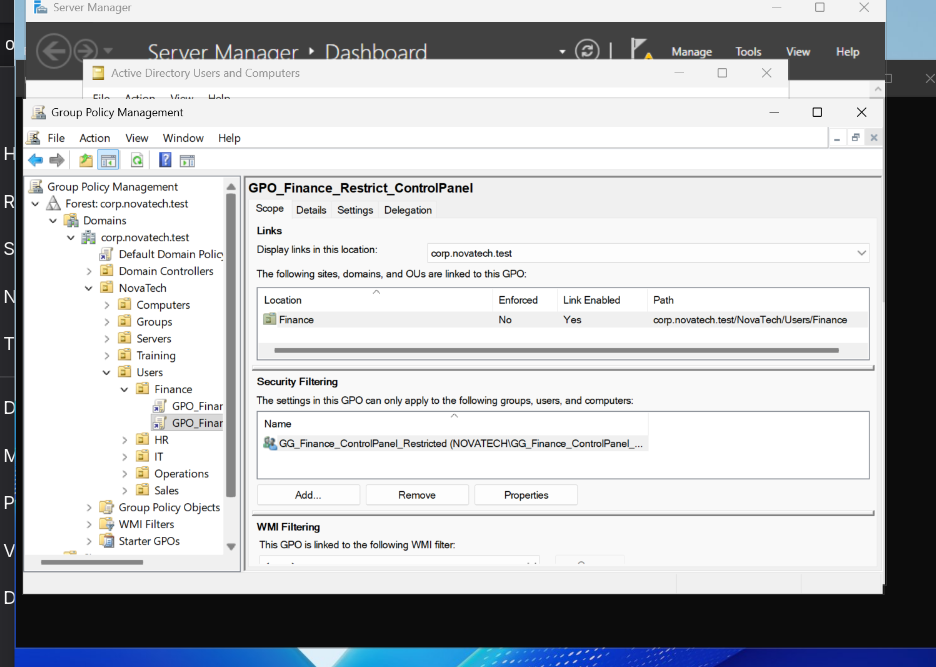
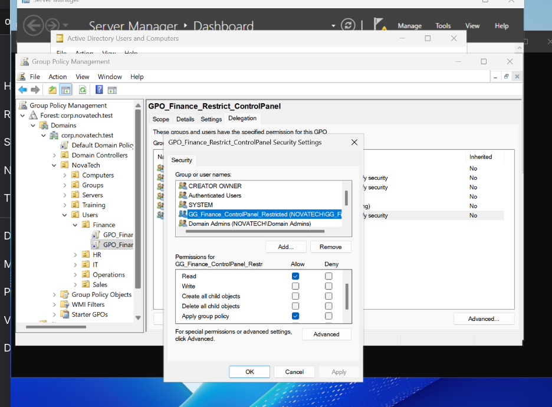
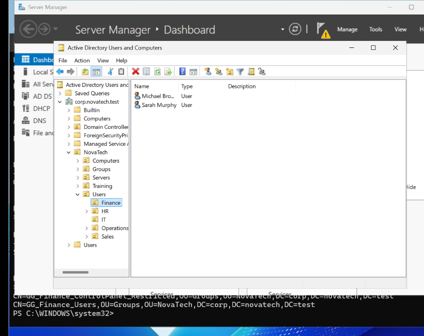

### Troubleshooting — stale logon group membership

The first test as Sarah showed `GPO_Finance_Restrict_ControlPanel` **Denied (Security)**, and her new group was missing from the user security groups reported by `gpresult`. ADUC confirmed Sarah was a group member. After obtaining a fresh logon token, her group appeared and the GPO applied. This illustrates why updating policy and updating logon group membership are different operations.

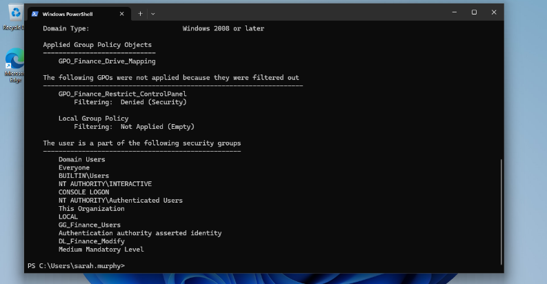

### Functional comparison

| Test | Sarah Murphy | Michael Brown |
|---|---|---|
| Finance OU | Yes | Yes |
| Member of target security group | Yes | No |
| Control Panel restriction GPO | Applied | Denied (Security) |
| Control Panel | Blocked | Opens normally |

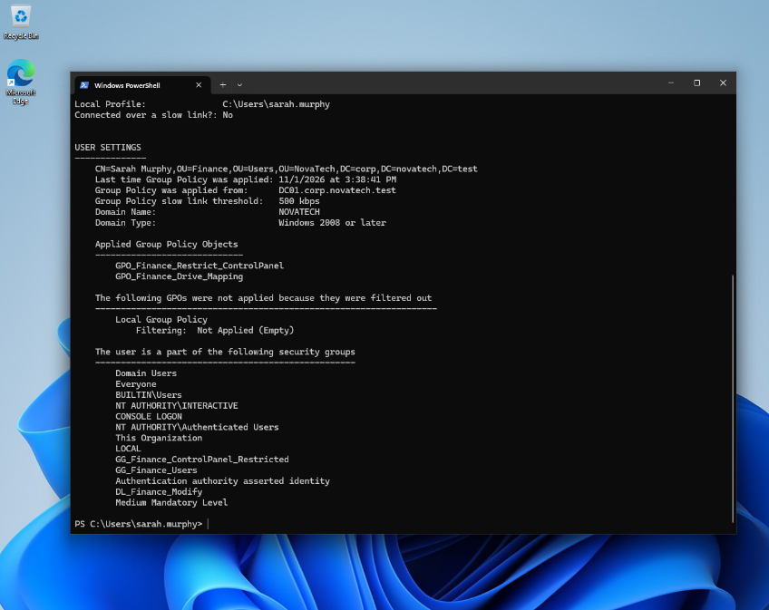
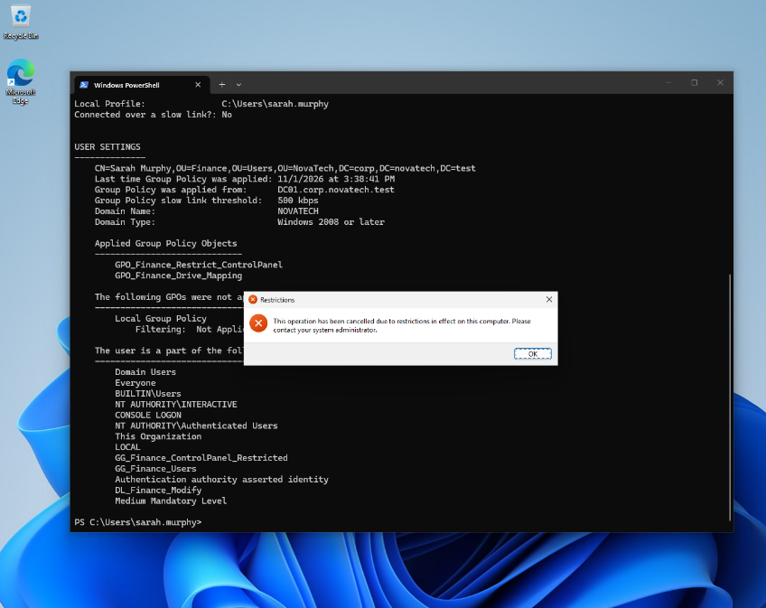
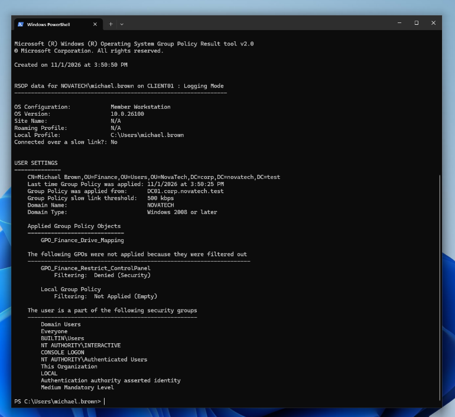
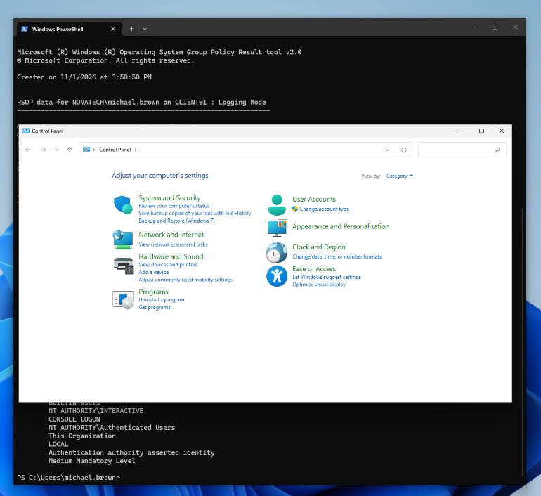

```powershell
# CLIENT01, while logged on as the intended domain user
whoami
whoami /groups
gpupdate /target:user /force
gpresult /scope user /r

# DC01: verify directory group membership
Get-ADGroupMember -Identity 'GG_Finance_ControlPanel_Restricted' |
  Select-Object Name,SamAccountName,ObjectClass
```

**Result:** This is a controlled demonstration that **GPO link scope and security filtering are distinct**: both users were in the same OU, but only the authorized group member received the restriction.

## Evidence notes and screenshot selection

The 25 supplied screenshots are stored in `screenshots/group-policy/` and retain sequential, descriptive names. Some screenshots show intermediate troubleshooting rather than final outcomes. In particular, `15-usb-explorer-permission-prompt.png` is an ambiguous initial failure, whereas `16-usb-powershell-write-denied.png` shows an explicit access-denied error. `20-security-filter-initial-denial.png` records the stale-token problem before Sarah successfully received the GPO. `01-finance-group-nesting.png` relates to the prerequisite Finance access-group setup and `07-network-firewall-diagnostics.png` provides supplementary network diagnostics; neither should be mistaken for direct proof of a new GPO.

The key evidence for each completed exercise is linked immediately below its description, allowing GitHub to display screenshots inline.

## Lessons learned

1. **GPMC is not ADUC:** ADUC displays security groups and their directory locations; GPMC displays GPOs and OU links. An empty `Groups` OU in GPMC does not imply no AD security groups exist.
2. **Apply and Read are separate permissions:** A user GPO may require client-computer Read permission while only the target user group has Apply permission.
3. **Group membership is not instantly reflected in logon tokens:** Sign out/in after membership changes before diagnosing policy filtering.
4. **Policy application and functional enforcement are different checks:** Use both `gpresult` and an actual test.
5. **Troubleshooting evidence is useful:** Preserve a failed state alongside the corrected state and explain the root cause.


