# LAB-016 — Remote Support and Windows Administration

## Overview

This lab implemented and validated remote administration of the NovaTech Active Directory environment using **Remote Desktop Protocol (RDP)** and **Windows Remote Management (WinRM) / PowerShell Remoting**. It also examined remote access authorization, restricted RDP firewall source addresses, reproduced a connection failure, and gathered remote server health and event-log evidence.

**Environment:** VirtualBox on Fedora; Windows Server 2025 domain controller **DC01** (`192.168.10.10`); domain-joined Windows 11 workstation **CLIENT01** (`192.168.10.100`); Active Directory domain `corp.novatech.test`.

**Scope:** Lab-only configuration and validation. Production domain controllers require carefully controlled administrative access, appropriate segmentation, and organizational security policies.

## Objectives

- Configure and validate RDP with Network Level Authentication (NLA).
- Differentiate network connectivity, authentication, and remote-logon authorization.
- Audit remote-logon user rights and privileged group membership.
- Restrict inbound RDP allow rules to an authorized management workstation and validate both positive and negative connectivity tests.
- Inspect WinRM service, listeners, and firewall rules.
- Authenticate with Kerberos and execute commands remotely using interactive and persistent PowerShell sessions.
- Collect server-health information and recent System event errors remotely.

## 1. RDP Configuration and Connectivity

### Server-side configuration

On DC01, the initial RDP registry setting `fDenyTSConnections` was `1` (connections disabled), and the Remote Desktop Services service was stopped. RDP was enabled through Windows remote settings with **Network Level Authentication** required. Subsequent checks confirmed:

- `fDenyTSConnections = 0` — RDP enabled.
- `UserAuthentication = 1` — NLA required.
- Remote Desktop inbound firewall allow rules enabled.
- TCP port **3389** listening on DC01.

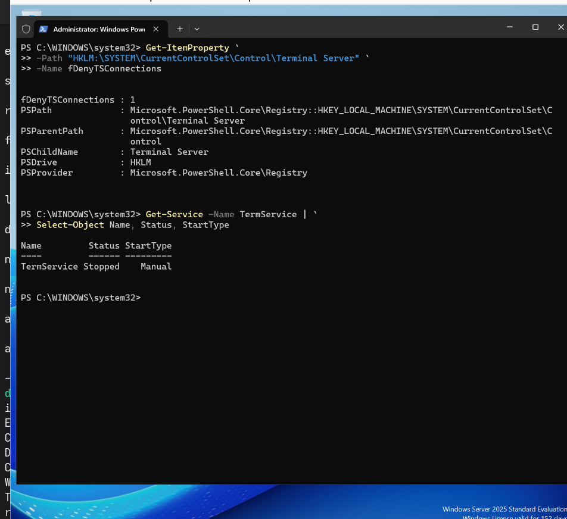
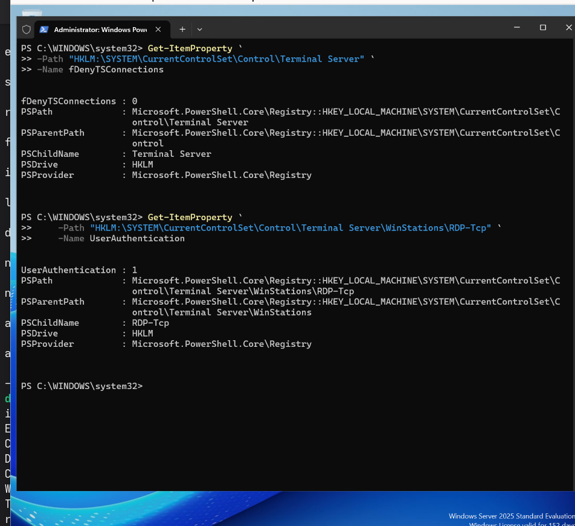
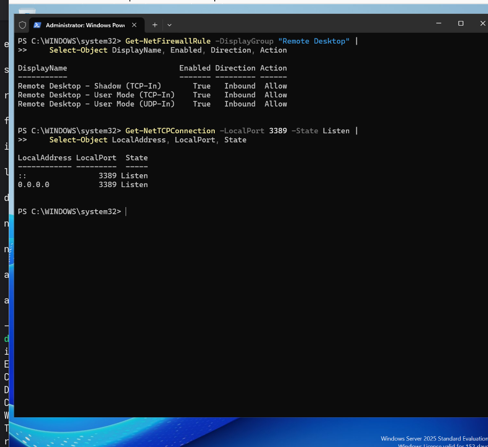

### Client connectivity and remote session

CLIENT01 successfully reached DC01 on TCP 3389:

```powershell
Test-NetConnection -ComputerName 192.168.10.10 -Port 3389
```

`TcpTestSucceeded : True` confirmed TCP reachability. A subsequent `mstsc` session authenticated as `NOVATECH\Administrator`; `hostname`, `whoami`, and `quser` on DC01 confirmed the remote machine, administrative identity, and active RDP session.

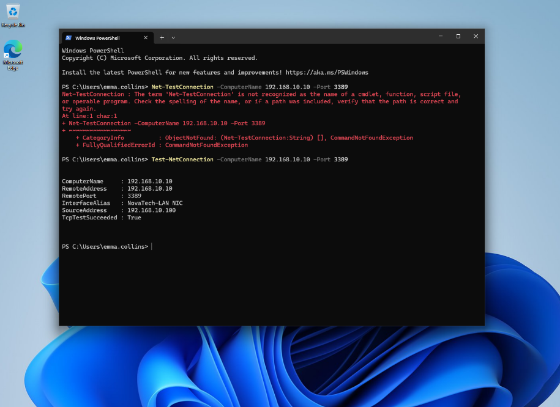
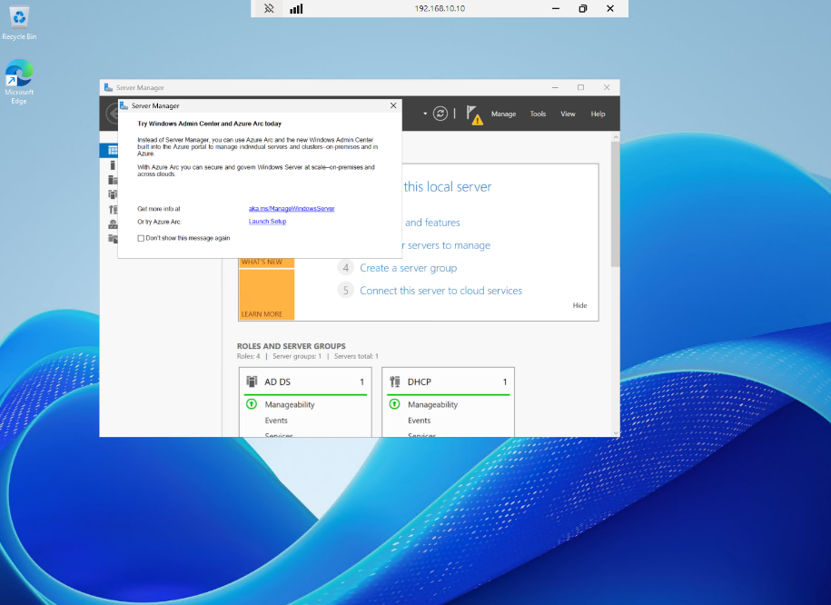
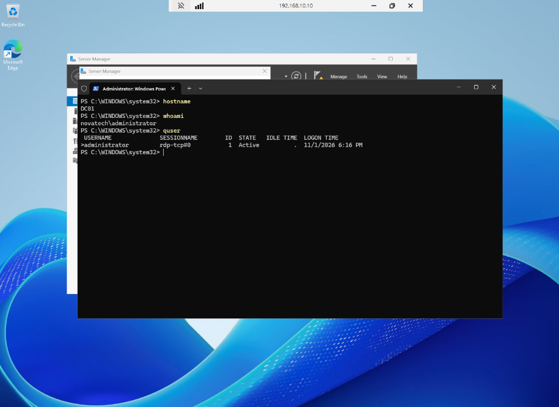

## 2. RDP Firewall Troubleshooting

A controlled failure was reproduced by disabling the built-in Remote Desktop firewall rule group **from DC01's VirtualBox console**, preserving console access:

```powershell
Disable-NetFirewallRule -DisplayGroup 'Remote Desktop'
```

CLIENT01 then tested TCP 3389. The connection failed while basic network connectivity could still work, distinguishing a blocked application port from an unreachable host. The rule group was re-enabled and connectivity was restored:

```powershell
Enable-NetFirewallRule -DisplayGroup 'Remote Desktop'
```

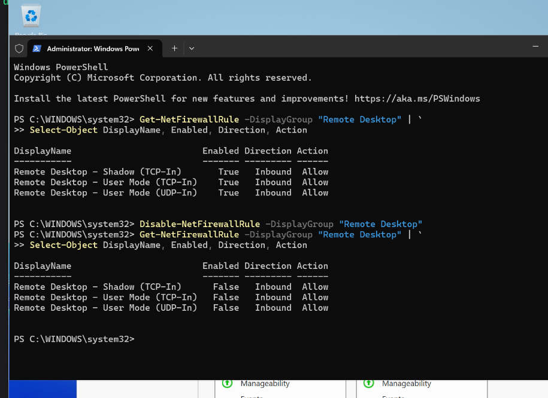
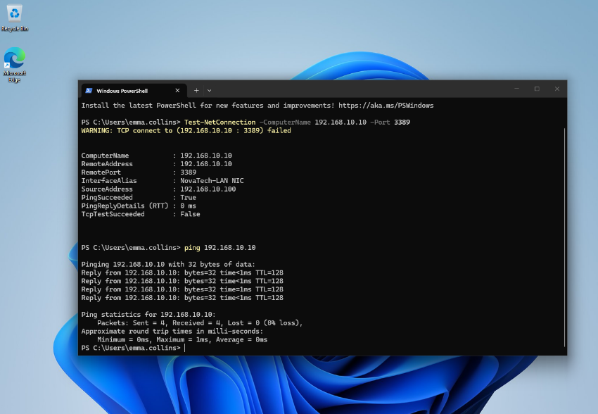
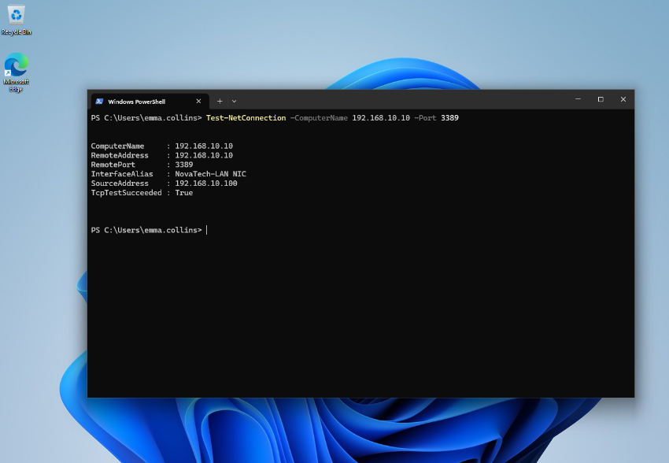

## 3. Remote Logon Rights and Privileged Access Audit

DC01's user-rights assignments were exported for inspection, without modifying the policy:

```powershell
secedit /export /cfg C:\Windows\Temp\rdp-security.cfg /areas USER_RIGHTS
Select-String -Path 'C:\Windows\Temp\rdp-security.cfg' `
  -Pattern 'SeRemoteInteractiveLogonRight|SeDenyRemoteInteractiveLogonRight'
```

The exported allow right included `*S-1-5-32-544`, the SID of the built-in **Administrators** group. This establishes a configured remote-logon right, not a complete proof of every effective access decision. The exported search did not show a matching deny-right entry.

The direct membership of the **Domain Admins** group was inspected:

```powershell
Get-ADGroupMember 'Domain Admins' |
  Select-Object Name, SamAccountName, ObjectClass
```

The result showed **Administrator** as the sole *direct* member returned. This does not enumerate every possible indirect or delegated administrative permission.

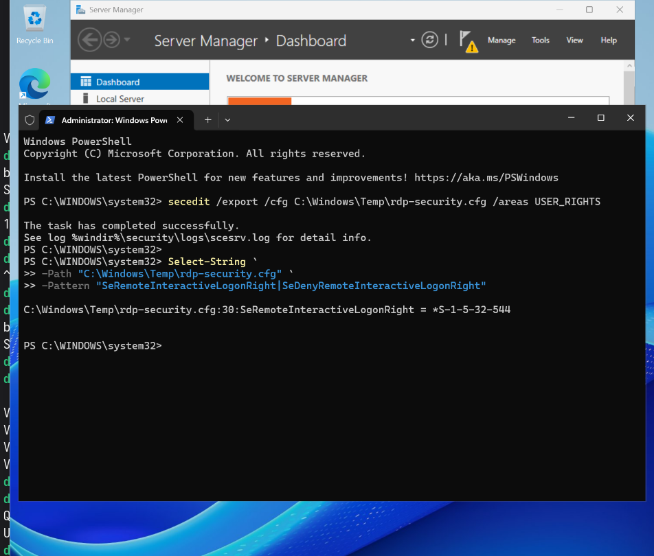
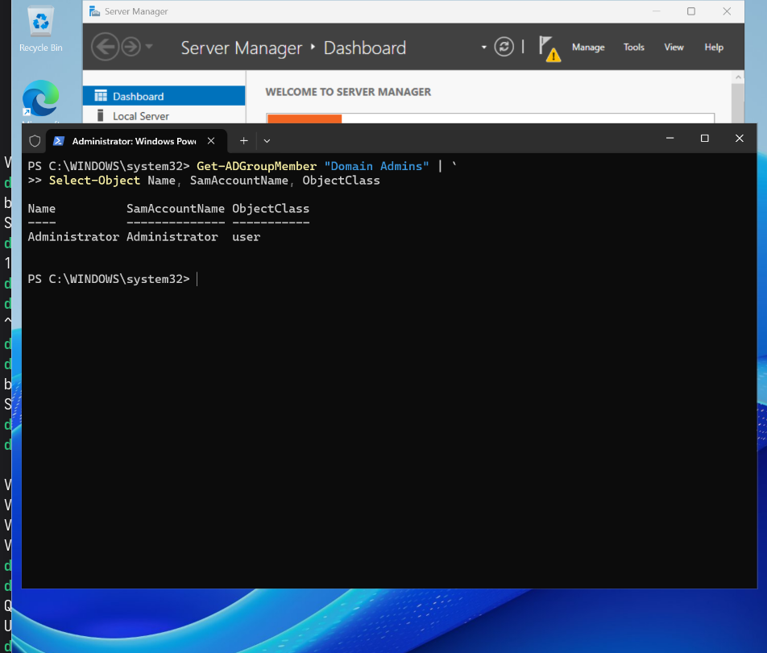

## 4. RDP Source-IP Restriction and Validation

An inspection of the inbound RDP allow rules showed `RemoteAddress = Any` for all three rules. The Windows Firewall policy was backed up:

```powershell
New-Item -ItemType Directory -Path C:\NovaTech-Reports -Force
netsh advfirewall export 'C:\NovaTech-Reports\firewall-before-rdp-hardening.wfw'
```

The RDP allow rules were then restricted to CLIENT01's management IP:

```powershell
Get-NetFirewallRule -DisplayGroup 'Remote Desktop' |
  Where-Object { $_.Direction -eq 'Inbound' -and $_.Action -eq 'Allow' } |
  Set-NetFirewallRule -RemoteAddress '192.168.10.100'
```

Verification showed `192.168.10.100` on each of the three rule address filters. From CLIENT01, `Test-NetConnection 192.168.10.10 -Port 3389` returned **True**, and an actual RDP login to DC01 succeeded.

A controlled **negative test** temporarily changed the allowed source address to `192.168.10.200` using the DC01 console. CLIENT01 still reached DC01 by ping but TCP 3389 failed (`TcpTestSucceeded : False`). The rule scope was **restored to `192.168.10.100`**, and CLIENT01's RDP connectivity was confirmed working again.

This test demonstrates the behavior of the modified allow rules under the tested conditions; it is not a complete audit of all possible firewall policies or network paths.


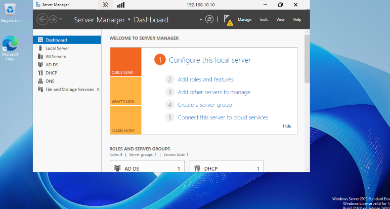
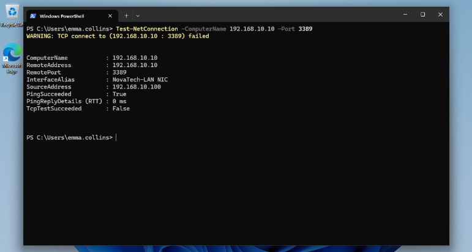

## 5. WinRM Service, Listener, and Firewall Inspection

The WinRM service was already **Running** with startup type **Automatic**:

```powershell
Get-Service -Name WinRM |
  Select-Object Name, DisplayName, Status, StartType
```

Listener inspection:

```powershell
winrm enumerate winrm/config/listener
```

The listener was enabled with `Address = *`, `Transport = HTTP`, `Port = 5985`, and `URLPrefix = wsman`. Its `ListeningOn` addresses included DC01's internal LAN address `192.168.10.10`, its VirtualBox NAT address `10.0.2.15`, and loopback/IPv6 addresses. A listener binding alone does not establish that every listed address is remotely accessible.

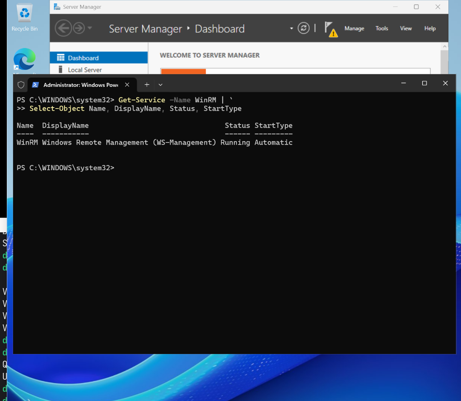
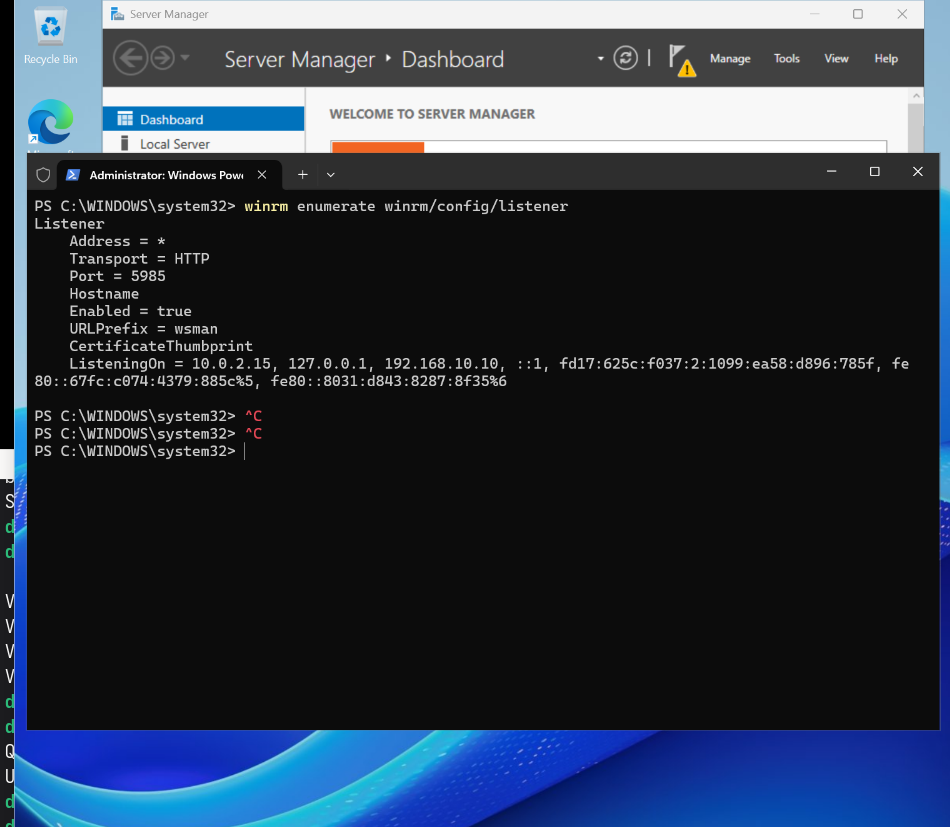

Firewall inspection:

```powershell
Get-NetFirewallRule |
  Where-Object {
    $_.DisplayGroup -eq 'Windows Remote Management' -and
    $_.Direction -eq 'Inbound'
  } |
  Select-Object DisplayName, Enabled, Action, Profile
```

Two enabled inbound allow rules for WinRM HTTP were returned: one for **Domain/Private** profiles and another for **Public**. The command did not inspect each rule's address scope or effective applicability. From CLIENT01, a TCP test to `DC01.corp.novatech.test:5985` returned **True**, with DNS resolving to `192.168.10.10`.

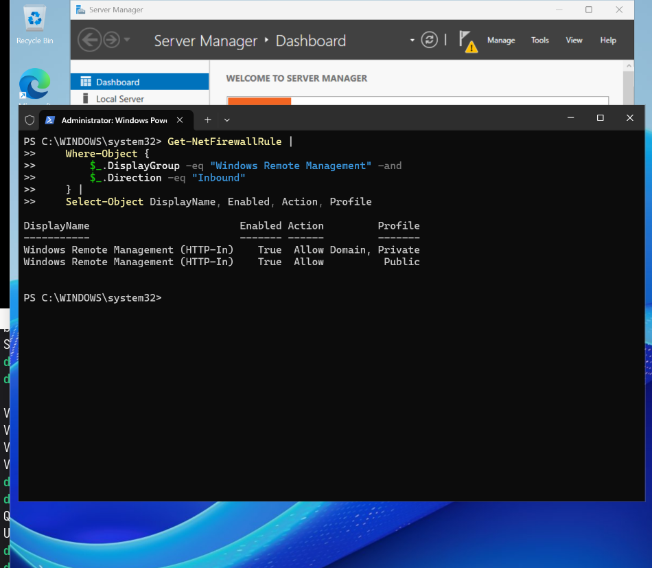
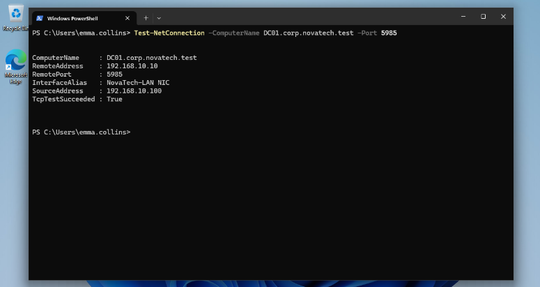

## 6. Kerberos Authentication and PowerShell Remoting

On CLIENT01, administrative credentials were requested interactively, avoiding a plaintext password in the command:

```powershell
$cred = Get-Credential -UserName 'NOVATECH\Administrator'
Test-WSMan -ComputerName DC01.corp.novatech.test `
  -Authentication Kerberos -Credential $cred
```

The successful WS-Management identity response reported **Microsoft Corporation** and WinRM stack version information, confirming authenticated WinRM communication. This was followed by actual remote command execution:

```powershell
Invoke-Command -ComputerName DC01.corp.novatech.test `
  -Credential $cred -Authentication Kerberos `
  -ScriptBlock { hostname; whoami }
```

The remote output was `DC01` and `novatech\administrator`, while `hostname` executed locally on CLIENT01 returned `CLIENT01`.

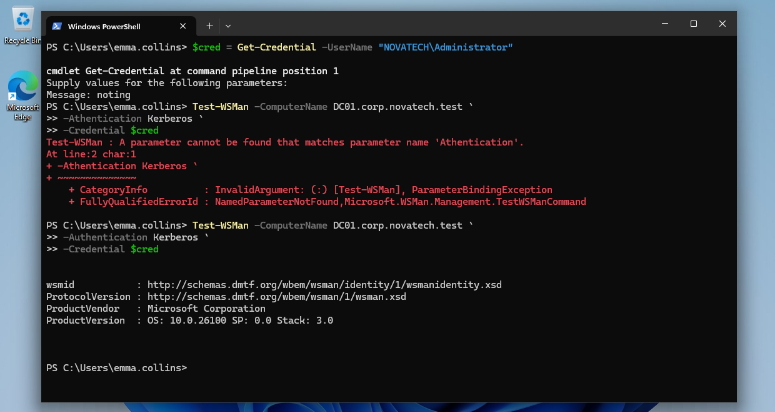
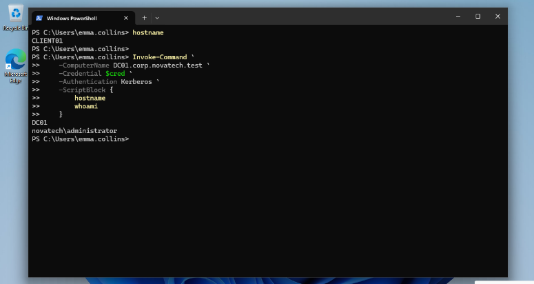

### Interactive remoting and session isolation

```powershell
Enter-PSSession -ComputerName DC01.corp.novatech.test -Credential $cred
hostname
whoami
Get-Service WinRM
```

The prompt changed to `[DC01.corp.novatech.test]:`, and the commands executed on DC01. A variable defined in that remote session was not automatically present in CLIENT01's local shell after `Exit-PSSession`; the local computer name again returned `CLIENT01`.

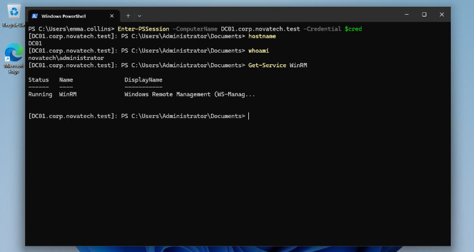
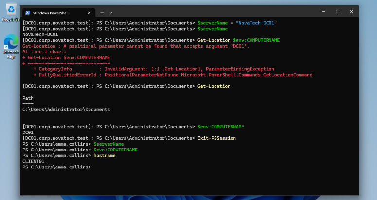

### Persistent session and reuse

```powershell
$session = New-PSSession -ComputerName DC01.corp.novatech.test -Credential $cred
Get-PSSession
Invoke-Command -Session $session -ScriptBlock { $department = 'NovaTech IT' }
Invoke-Command -Session $session -ScriptBlock { $department; hostname }
Remove-PSSession $session
```

The persistent session retained `$department` across separate `Invoke-Command` calls, returning `NovaTech IT` and `DC01`. The session was then closed to release remote resources.

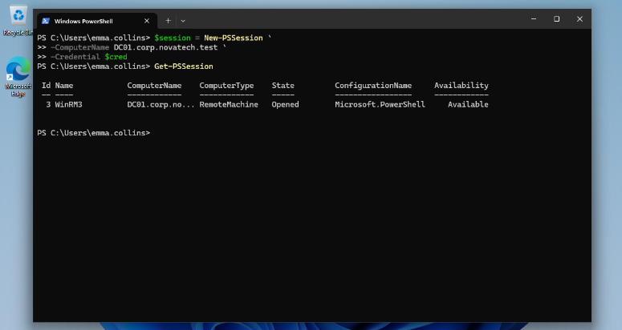
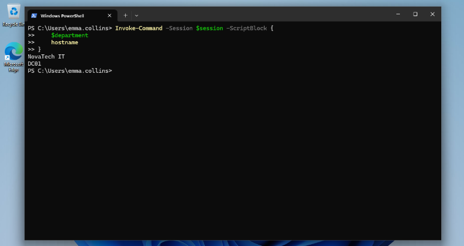

## 7. Remote Server Health Assessment

CLIENT01 queried DC01 without opening a remote desktop:

```powershell
Invoke-Command -ComputerName DC01.corp.novatech.test -Credential $cred -ScriptBlock {
    Write-Host '=== SERVER INFORMATION ==='
    Get-ComputerInfo | Select-Object CsName, OsName, OsLastBootUpTime

    Write-Host '=== MEMORY ==='
    Get-CimInstance Win32_OperatingSystem |
      Select-Object @{ Name = 'FreeMemoryGB'; Expression = {
        [math]::Round($_.FreePhysicalMemory / 1MB, 2)
      }}

    Write-Host '=== CRITICAL SERVICES ==='
    Get-Service NTDS, DNS, DHCPServer, WinRM |
      Select-Object Name, Status
}
```

**Observed results:** DC01 was running Windows Server 2025 Standard Evaluation; the last boot was reported on **2026-11-02 at 21:38:42** (server-local time); free physical memory was **2.72 GB**; and the **NTDS, DNS, DHCPServer, and WinRM** services all reported **Running**. Free memory alone is insufficient to determine whether the server has memory pressure.

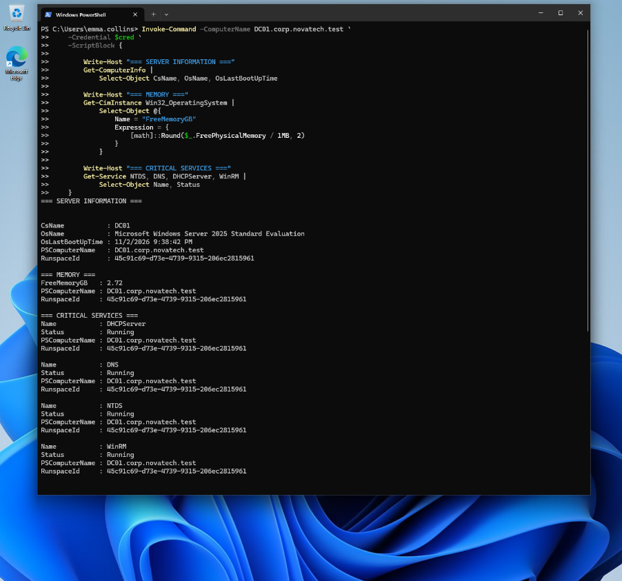

## 8. Remote System Event Log Investigation

```powershell
Invoke-Command -ComputerName DC01.corp.novatech.test -Credential $cred -ScriptBlock {
    Get-WinEvent -FilterHashtable @{
        LogName = 'System'
        Level = 2
        StartTime = (Get-Date).AddDays(-7)
    } -MaxEvents 5 -ErrorAction SilentlyContinue |
      Select-Object TimeCreated, Id, ProviderName, Message
}
```

The remote query returned these recent System errors:

| Event ID | Provider | Observed message / finding |
|---|---|---|
| 7 | Microsoft-Windows-Kerberos-Key-Distribution-Center | Security Account Manager failed a KDC request unexpectedly; lookup type `0x108` |
| 1036 | Microsoft-Windows-DHCP-Server | DHCP service could not create or look up the DHCP Administrators local group |
| 1035 | Microsoft-Windows-DHCP-Server | DHCP service could not create or look up the DHCP Users local group |
| 6008 | EventLog | Previous system shutdown was unexpected |

These are **investigation leads**, not confirmed root causes. No corrective changes were made in this exercise. Further diagnosis could include reviewing full event details, domain-controller group behavior, DHCP authorization and configuration, and VM shutdown history.

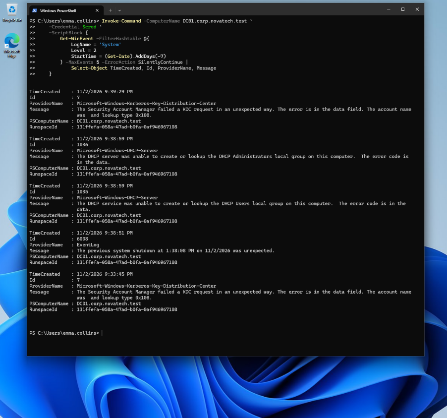

## Key Lessons and Security Considerations

1. **Reachability is not authorization:** An open TCP port does not grant permission to log in or execute remote commands.
2. **Use layered controls:** RDP access was protected by NLA, account permissions, and source-IP firewall filtering.
3. **Preserve recovery access:** Firewall changes were made with VirtualBox console access available and a firewall export saved.
4. **Validate both allowed and denied behavior:** Positive and negative tests confirmed the observed effects of the RDP rule scope changes.
5. **Choose the right tool:** RDP is useful for graphical tasks; PowerShell Remoting is efficient for command-line diagnostics and repeatable administration.
6. **Treat domain controllers as sensitive:** Administrative sessions should use authorized privileged accounts, and WinRM/RDP exposure should be limited according to policy.
7. **Separate findings from diagnoses:** Event IDs provide evidence for follow-up troubleshooting but do not by themselves establish the cause.

## Outcome

**Completed.** The NovaTech lab demonstrated working RDP and WinRM connectivity, successful Kerberos-authenticated PowerShell Remoting, interactive and persistent remote sessions, controlled RDP firewall restrictions, and remote health/event-log inspection. The original RDP allow-rule source scope was restored to the authorized CLIENT01 address (`192.168.10.100`) after negative testing.

**Screenshot directory:** [`screenshots/remote-administration/`](../../screenshots/remote-administration/)
