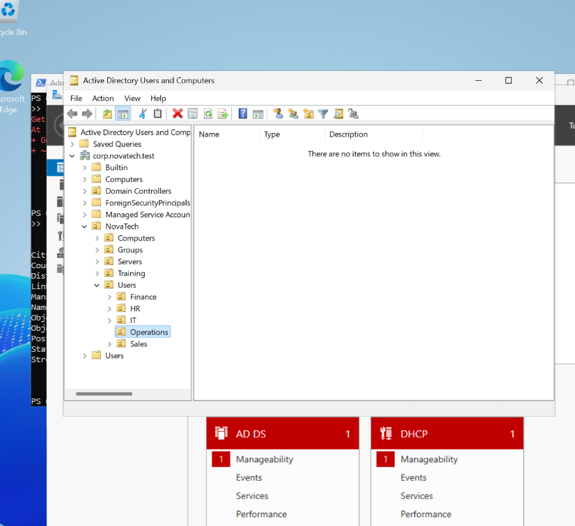
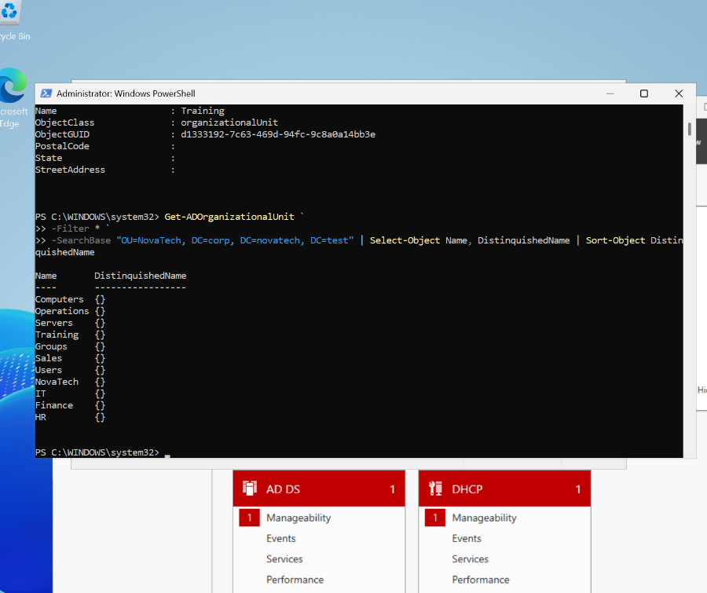

# Active Directory Organizational Units — NovaTech Lab

## Objective
Design and create an organizational unit (OU) hierarchy for a fictional enterprise, NovaTech Solutions, to support centralized user/computer administration, delegated administration, and Group Policy targeting.

## Environment

| Component | Configuration |
|---|---|
| Domain | `corp.novatech.test` |
| Domain controller | `DC01` |
| Server OS | Windows Server 2025 |
| Domain DN | `DC=corp,DC=novatech,DC=test` |
| Management tools | Active Directory Users and Computers (ADUC), PowerShell ActiveDirectory module |

## OU design

```text
corp.novatech.test
└── NovaTech
    ├── Users
    │   ├── IT
    │   ├── HR
    │   ├── Finance
    │   ├── Sales
    │   └── Operations
    ├── Computers
    ├── Servers
    ├── Groups
    └── Training
```

`Training` is an optional practice OU. The structure separates objects by administrative purpose; OU membership alone does not grant access to resources. Security groups will be used for permissions in later labs.

## Implementation

### GUI

1. Open **Server Manager → Tools → Active Directory Users and Computers** (`dsa.msc`).
2. Right-click the domain → **New → Organizational Unit** → create `NovaTech`.
3. Inside `NovaTech`, create `Users`, `Computers`, `Servers`, and `Groups`.
4. Inside `Users`, create `IT`, `HR`, `Finance`, `Sales`, and `Operations`.
5. Leave **Protect container from accidental deletion** enabled.

### PowerShell discovery

```powershell
Import-Module ActiveDirectory
Get-ADDomain | Select-Object DNSRoot,DistinguishedName,NetBIOSName
$domainDN = (Get-ADDomain).DistinguishedName
$baseOU = "OU=NovaTech,$domainDN"
Get-ADOrganizationalUnit -Filter * -SearchBase $baseOU |
    Select-Object Name,DistinguishedName |
    Sort-Object DistinguishedName
```

### Create a practice OU

```powershell
New-ADOrganizationalUnit -Name 'Training' -Path $baseOU -ProtectedFromAccidentalDeletion $true
Get-ADOrganizationalUnit -Identity "OU=Training,$baseOU"
```

Run the creation command only if the OU does not already exist.

## Understanding distinguished names

Example:

```text
OU=Finance,OU=Users,OU=NovaTech,DC=corp,DC=novatech,DC=test
```

- `OU=` identifies organizational units, from the object outward through its parent OUs.
- `DC=` identifies DNS domain name components. Here `corp.novatech.test` has three labels.
- `CN=` identifies common-name objects or containers; the default `CN=Computers` is not an OU.
- A DN is an object's full directory location. Discover the domain DN with `Get-ADDomain` instead of assuming it from a company's public website.

## Verification

```powershell
Get-ADOrganizationalUnit -Filter * -SearchBase $baseOU |
    Select-Object Name,DistinguishedName
Get-ADOrganizationalUnit -Identity "OU=Finance,OU=Users,$baseOU" |
    Select-Object Name,DistinguishedName,ProtectedFromAccidentalDeletion
```

## Evidence

### OU hierarchy in ADUC



### PowerShell OU verification



## Key lessons

- An OU organizes directory objects and provides a scope for administration and Group Policy.
- OUs can contain users, groups, computers, and nested OUs.
- A security group, not OU placement alone, is normally used to grant resource access.
- `-Path` specifies the **parent container** where a new OU is created.
- The default `CN=Computers` container differs from a custom `OU=Computers`.
- Use discovery and verification commands before making changes in an unfamiliar domain.

## Outcome

Designed and configured a departmental OU hierarchy for the NovaTech lab and verified it using ADUC and PowerShell. The structure is ready for user provisioning, group management, workstation placement, and Group Policy exercises.
