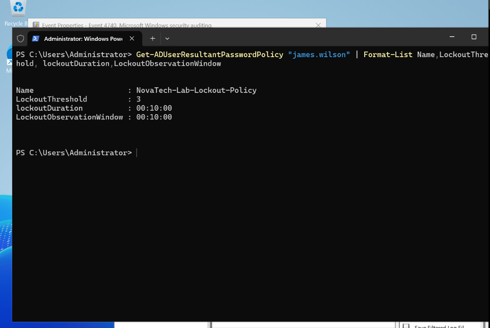
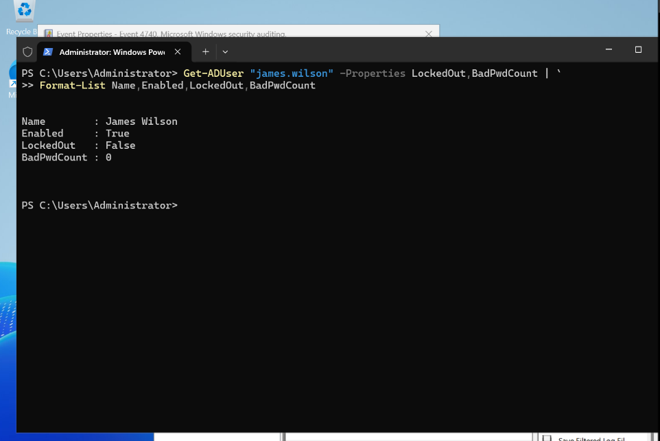
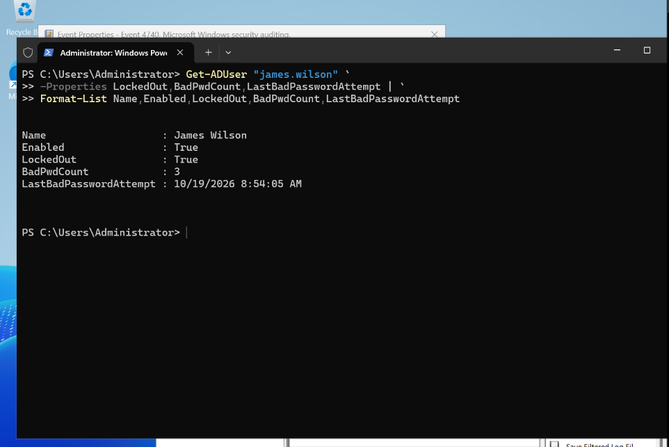
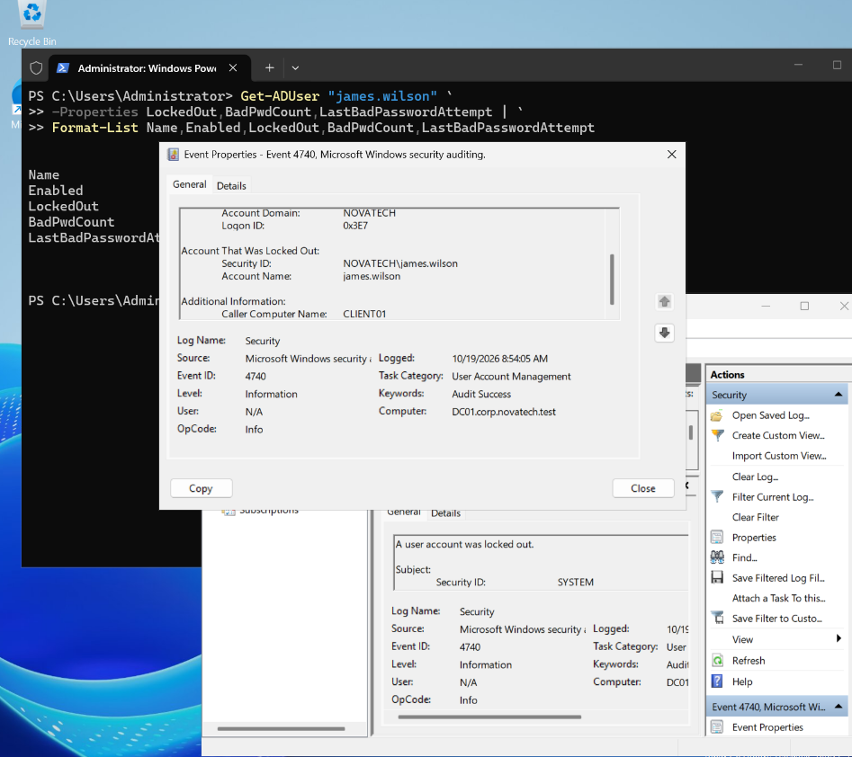
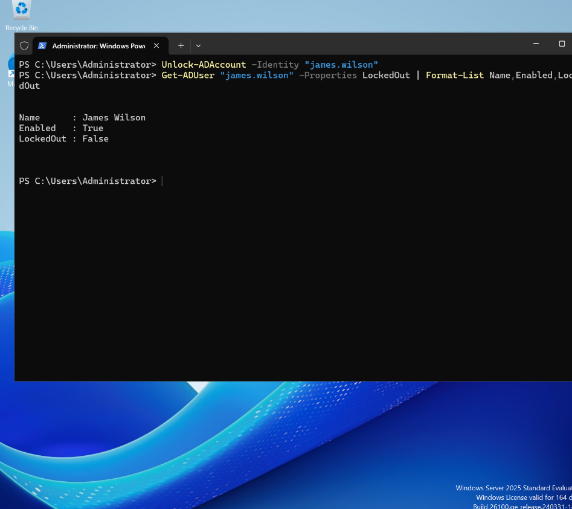
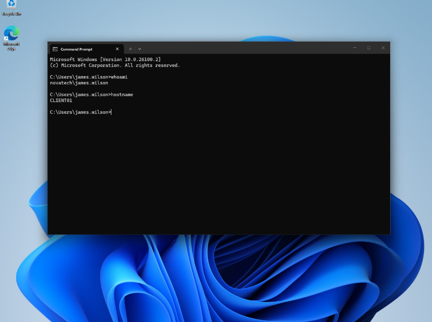

# INC-003 — Active Directory Account Lockout Investigation

**Environment:** NovaTech Windows IT Support Lab  
**Domain:** `corp.novatech.test`  
**Domain controller:** DC01 — Windows Server 2025 (`192.168.10.10`)  
**Client workstation:** CLIENT01 — Windows 11  
**Test account:** `NOVATECH\james.wilson`  
**Incident type:** Account authentication / lockout  
**Scenario:** Controlled lab simulation

## 1. Incident summary

A simulated helpdesk ticket reported that James Wilson could not sign in to his domain account after repeated incorrect password attempts. The objective was to reproduce an account lockout in an isolated Active Directory lab, inspect account state and security events, and restore access.

> **Scope:** This is a controlled training scenario, not an incident involving a real employee. The screenshots and commands below are the intended evidence trail. Confirm the actual outputs against the captured screenshots before treating each observation as verified.

## 2. Lab configuration

DC01 hosts Active Directory Domain Services for `corp.novatech.test`. CLIENT01 is joined to the domain. A Fine-Grained Password Policy named `NovaTech-Lab-Lockout-Policy` was assigned to `james.wilson` so that the exercise would not require changing the default domain lockout policy.

| Setting | Lab value |
| --- | --- |
| Lockout threshold | 3 counted failed attempts |
| Lockout duration | 10 minutes |
| Reset account lockout counter after | 10 minutes |

**Evidence — resultant password policy:**



To inspect the effective policy:

```powershell
Get-ADUserResultantPasswordPolicy -Identity "james.wilson" |
    Format-List Name,LockoutThreshold,LockoutDuration,LockoutObservationWindow
```

## 3. Initial investigation

The account state was checked on DC01 before attempting the simulated sign-in failures.

```powershell
Get-ADUser "james.wilson" -Properties LockedOut,BadPwdCount |
    Format-List Name,Enabled,LockedOut,BadPwdCount
```

The purpose of this check was to distinguish an enabled, unlocked account from one that was already disabled or locked. The screenshot records the observed state.



## 4. Reproducing the issue

On CLIENT01, the test account `NOVATECH\james.wilson` was used for controlled incorrect-password attempts, within the configured observation window. The test was limited to the isolated lab account.

After the sign-in attempts, the account state was queried again on DC01:

```powershell
Get-ADUser "james.wilson" `
    -Properties LockedOut,BadPwdCount,LastBadPasswordAttempt |
    Format-List Name,Enabled,LockedOut,BadPwdCount,LastBadPasswordAttempt
```

**Evidence — account state following failed authentication:**



**Verification note:** Confirm that the screenshot actually shows `LockedOut : True`. If it does not, describe the observed result instead; the lockout threshold may not have been reached, or the timed lockout may have expired.

## 5. Security event investigation

On DC01, the Windows Security log was examined for **Event ID 4740**, *A user account was locked out*.

GUI path:

`Event Viewer → Windows Logs → Security → Filter Current Log → Event ID 4740`

An equivalent PowerShell query is:

```powershell
Get-WinEvent -FilterHashtable @{
    LogName   = 'Security'
    Id        = 4740
    StartTime = (Get-Date).AddHours(-1)
} | Select-Object TimeCreated,Id,Message | Format-List
```



**Fields to record from the event (if present):**

- Locked-out account: `james.wilson`
- Event time: *Refer to screenshot*
- Caller Computer Name: *Refer to screenshot; do not assume it is CLIENT01*

Event 4740 can help identify a lockout and a reported caller computer, but does not always establish the complete origin of repeated authentication failures.

## 6. Root-cause assessment

**Known cause of the lab scenario:** Incorrect password attempts were deliberately generated against the test account to demonstrate the configured lockout policy.

**Production troubleshooting consideration:** Repeated lockouts can also be caused by stale credentials in services, scheduled tasks, saved connections, other devices, or unauthorized authentication attempts. A real incident would require correlating logs and checking the source before concluding why the failures occurred.

## 7. Resolution

If the account was still locked when the administrator intervened, the intended recovery command was:

```powershell
Unlock-ADAccount -Identity "james.wilson"
```

Account status can then be checked with:

```powershell
Get-ADUser "james.wilson" -Properties LockedOut |
    Format-List Name,Enabled,LockedOut
```



**Verification note:** The policy also allows automatic unlock after 10 minutes. If the account unlocked automatically, document that instead of claiming a manual unlock caused the recovery.

## 8. Post-resolution verification

On CLIENT01, the test user signs in using the correct domain credentials. The session identity and workstation can be checked using:

```powershell
whoami
hostname
```

Expected values for a successful test:

```text
novatech\james.wilson
CLIENT01
```



**Verification note:** A screenshot showing the successful sign-in confirms recovery; the commands alone do not.

## 9. Lessons learned

1. **Locked and disabled are different states.** A locked account can remain enabled; a disabled account requires a separate administrative decision to enable it.
2. **Fine-Grained Password Policies** allow lockout testing for a selected account without modifying the domain-wide default policy.
3. **Event ID 4740** is useful evidence, but a caller computer name is not always definitive proof of the underlying cause.
4. **Unlocking an account is not the same as resetting its password.** The correct action depends on the incident.
5. **Recovery must be verified** with both account-state checks and a successful domain sign-in.

## 10. Evidence index

| Screenshot | Description |
| --- | --- |
| [01 — Lockout policy](../screenshots/active-directory/troubleshooting/01-james-lockout-policy.png) | Effective Fine-Grained Password Policy |
| [02 — Before lockout](../screenshots/active-directory/troubleshooting/02-account-before-lockout.png) | Initial AD account state |
| [03 — Locked account](../screenshots/active-directory/troubleshooting/03-account-locked.png) | AD account state after failed attempts |
| [04 — Event 4740](../screenshots/active-directory/troubleshooting/04-event-4740-lockout.png) | Security log evidence |
| [05 — Account recovered](../screenshots/active-directory/troubleshooting/05-account-unlocked.png) | Account state after unlock or lockout expiration |
| [06 — Successful login](../screenshots/active-directory/troubleshooting/06-james-login-success.png) | CLIENT01 domain authentication verification |

---

**Status:** Training exercise documented. Review screenshot contents to confirm the observed lockout, event details, recovery method, and successful sign-in before marking the incident fully verified.
