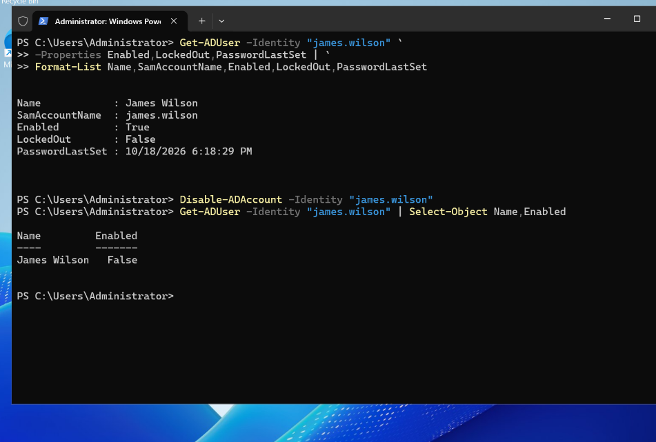
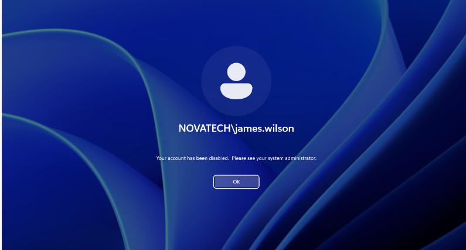
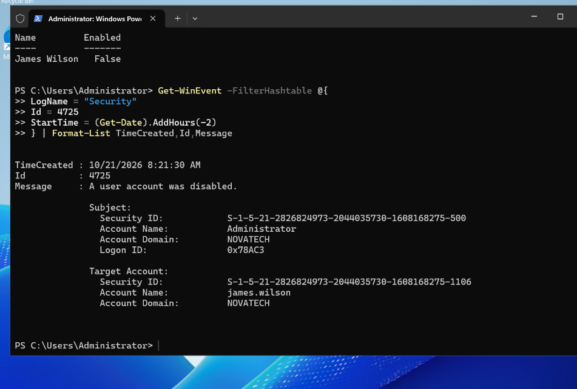
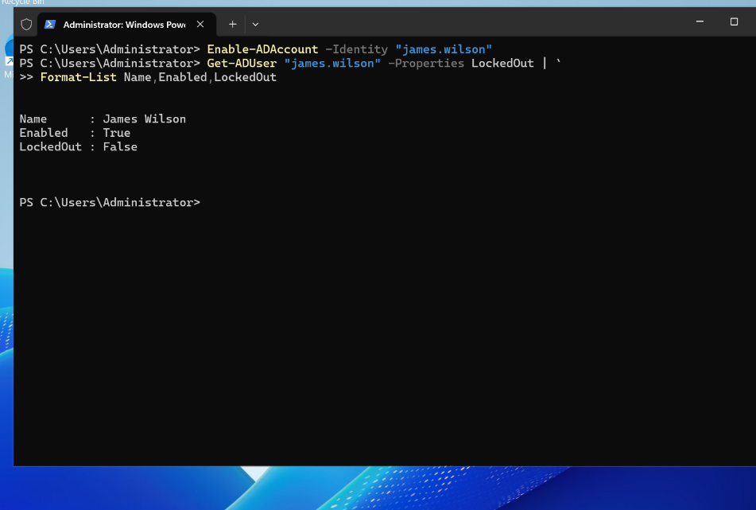

# INC-004 — Disabled Active Directory User Account

**Status:** Resolved — lab simulation  
**Date:** 21 October 2026  
**Environment:** NovaTech Windows IT Support Lab  
**Domain:** `corp.novatech.test` (`NOVATECH`)  
**Domain controller:** DC01 — Windows Server 2025  
**Workstation:** CLIENT01 — Windows 11  
**Affected account:** `NOVATECH\james.wilson` (James Wilson, IT)

## Incident summary

A simulated helpdesk incident was created to investigate why an employee could not sign in despite knowing the account password. The lab account was deliberately disabled by an administrator. A subsequent interactive sign-in on CLIENT01 displayed: **“Your account has been disabled. Please see your system administrator.”**

The exercise demonstrated how to distinguish a disabled account from a locked account, confirm the administrative action using the Windows Security log, and restore and verify access.

## 1. Initial account state and reproduction

On DC01, the following query confirmed the account was enabled and not locked:

```powershell
Get-ADUser -Identity "james.wilson" `
    -Properties Enabled,LockedOut,PasswordLastSet |
    Format-List Name,SamAccountName,Enabled,LockedOut,PasswordLastSet
```

Observed before the change:

- `Enabled: True`
- `LockedOut: False`
- `PasswordLastSet: 10/18/2026 6:18:29 PM` (as displayed in the VM)

The account was then deliberately disabled:

```powershell
Disable-ADAccount -Identity "james.wilson"
Get-ADUser -Identity "james.wilson" | Select-Object Name,Enabled
```

**Observed:** `James Wilson — Enabled: False`.



## 2. Confirm the user-facing symptom

On CLIENT01, an interactive sign-in was attempted using `NOVATECH\james.wilson`.

**Observed Windows error:** “Your account has been disabled. Please see your system administrator.”



This confirmed that the account's disabled state prevented the attempted sign-in. A disabled account and a locked account are different states: `Enabled=False` is not equivalent to `LockedOut=True`.

## 3. Investigate Security Event ID 4725

On DC01, the Windows Security log was queried for user-account disable events:

```powershell
Get-WinEvent -FilterHashtable @{
    LogName   = "Security"
    Id        = 4725
    StartTime = (Get-Date).AddHours(-2)
} | Format-List TimeCreated,Id,Message
```

**Observed event details:**

| Field | Value |
|---|---|
| Event ID | `4725` — A user account was disabled |
| TimeCreated | `10/21/2026 8:21:30 AM` (VM-displayed time) |
| Subject account | `Administrator` |
| Subject domain | `NOVATECH` |
| Target account | `james.wilson` |
| Target domain | `NOVATECH` |

The **Subject** identifies the security principal performing the operation; the **Target Account** identifies the account that was disabled. In this controlled test, the event supports the conclusion that `NOVATECH\Administrator` disabled `NOVATECH\james.wilson`.



## 4. Resolution

Because this was an authorized lab simulation, the administrator restored the account:

```powershell
Enable-ADAccount -Identity "james.wilson"
Get-ADUser "james.wilson" -Properties LockedOut |
    Format-List Name,Enabled,LockedOut
```

**Observed after recovery:**

```text
Name      : James Wilson
Enabled   : True
LockedOut : False
```



## 5. End-user verification

James successfully signed in to CLIENT01. In the user session, Command Prompt returned:

```cmd
hostname
whoami
```

```text
CLIENT01
novatech\james.wilson
```

This confirms an interactive session was established under James's domain identity on the expected workstation.


## Root cause and outcome

**Root cause in this lab:** An intentional administrative `Disable-ADAccount` action changed James's AD account to `Enabled=False`. Security Event 4725 corroborated the action and identified the administrative subject. The resulting disabled state caused the observed Windows sign-in rejection.

**Resolution:** The account was re-enabled, its enabled/unlocked state verified, and a successful CLIENT01 domain session confirmed.

**Production consideration:** Never re-enable a disabled employee account solely because a user reports a login problem. Confirm the business authorization and investigate whether the disablement resulted from offboarding, HR action, or a security response. Event 4725 identifies the principal that performed the operation, but by itself does not establish the business reason.

## Lessons learned

- `Get-ADUser` checks account properties; `Disable-ADAccount` and `Enable-ADAccount` change the enabled state.
- `Enabled=False` differs from an authentication lockout (`LockedOut=True`).
- Event ID `4725` provides auditable evidence of account disablement when the relevant audit policy is active.
- Always verify both the AD account state and the user's ability to sign in after an authorized recovery.
- Capture before/action, symptom, audit evidence, recovery, and user validation in the incident record.
